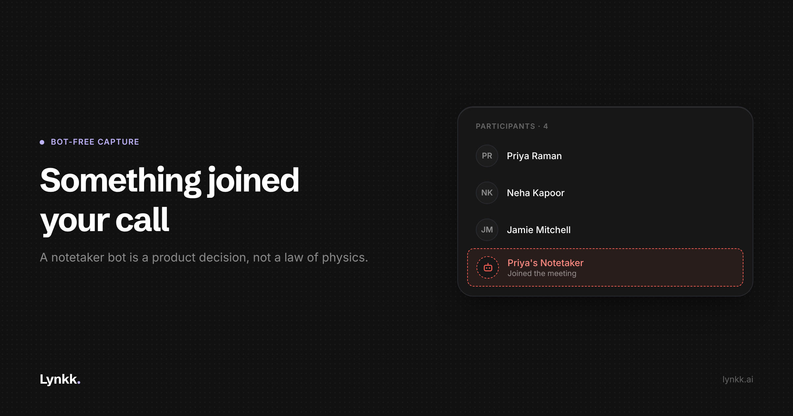

# AI Note Takers That Do Not Join Your Meeting

<!-- Cover: dark theme, 2400x1260 (2x of 1200x630). Light variant alongside at
     ../images/2026-11-02-bot-free-ai-note-takers/cover-light.png
     On the lynkk.ai blog this file is served from: /images/blog/2026-11-02-bot-free-ai-note-takers/cover.png
     On Medium: upload it as the feature image, then DELETE this image line and this
     comment, or the cover will appear twice. -->

*Disclosure: I work on Lynkk, which offers both capture models described here. Lynkk appears once, in a marked section at the end.*

---

There is a particular silence on a sales call when a notetaker bot joins. The customer stops, looks at the participant list, and says "what's that?"

You explain. They say "sure, that's fine". The call resumes.

Nothing bad happened, except that the first ninety seconds of a conversation you prepared for went on administering your own tooling. And the person on the other side now knows there is a recording, and has not quite been asked.

Most AI note takers work this way for good reasons. But it is a choice, not a requirement.

## What the bot is, and why it exists

A notetaker bot is a participant. It dials into the Zoom, Meet or Teams call like a person, using the meeting link, and appears in the list with a name like "Priya's Notetaker".

It exists because being a participant is the easiest way to get clean audio. The platform hands the bot a proper media stream, often with separate audio per speaker, which makes labelling who said what far easier.

It also decouples capture from any device. The bot can sit in a call you joined from your phone, or one you are five minutes late to, or one you are not in at all.

**That last property is the real reason bots dominate.** A bot can record a meeting you are not attending. Nothing running on your device can.

## What bot-free capture actually is

The alternative is to record on the machine you are already using. In practice that means a browser extension capturing the audio of the tab the call runs in, or a desktop app capturing system audio and your microphone together.

No extra participant appears. The platform does not know anything unusual is happening, because nothing is: your computer is recording its own audio output and microphone, the way a screen recorder does.

## Four reasons people want this

**External and client-facing calls.** Internal standups do not care. A first call with a prospect is different. A bot in the list is a visible piece of your infrastructure sitting in a conversation where you are trying to look competent and easy to work with.

**Consent that happens properly.** This one cuts against intuition. A bot looks like disclosure, and it is thin disclosure: a name in a list nobody reads, which does not announce itself. Without a bot there is nothing to hide behind, so you have to say it out loud, which is better consent and takes four seconds.

**Platforms and policies that block bots.** Plenty of enterprises disable third-party apps in Zoom or Teams, or block unknown participants. Some customers' IT will not admit a bot from the waiting room. If you sell into regulated industries, you will hit this.

**Meetings with no link at all.** In-person conversations, a phone call on speaker, a conference corridor. There is no meeting for a bot to join.

## What you give up

Vendors selling bot-free capture tend to be quiet about these.

- **Your device has to be there, on, and awake.** No laptop, no recording. Close the lid and you may lose the session.
- **You cannot capture a meeting you are not in.** Delegating recording to a bot is a genuine feature.
- **Speaker separation is harder.** Recording system audio gives a mixed stream where everyone on the far side arrives on one channel, so voices must be separated acoustically. Ask the question directly.
- **Usually no video.** Bots commonly record gallery view. Local audio capture typically does not.
- **Battery and thermals.** An hour of recording and transcription on a laptop is real work.

## So which one, when

The question is wrong. You want both, available per call, chosen when the call starts.

| Situation | Use |
|---|---|
| Internal meeting, or one you are not attending | Bot |
| First call with a prospect | No bot |
| Customer with strict IT | No bot, the bot will not get in |
| In person | Device capture, necessarily |
| Joining from your phone, or running late | Bot, nothing else will be there |

Treating this as a vendor-level religious position is the mistake. It is a per-meeting decision.

## Questions to ask before you buy

1. Do you offer both bot and bot-free capture, or only one?
2. For bot-free capture, do you label speakers, given the audio arrives mixed?
3. Does it capture system audio and the microphone, or only the browser tab?
4. What happens if I close the lid, or the machine sleeps?
5. Does the bot announce itself, or only appear in the participant list?
6. Can I use bot-free capture for in-person conversations too?
7. What do you do with the audio, and do you train models on it?

## How Lynkk does it

As disclosed, I work on Lynkk, so this is the vendor's own account.

Lynkk offers both, for the reason above: neither model covers every meeting. There is a [meeting bot](https://lynkk.ai/features/meeting-bot) you send with a call link or via calendar auto-join, which is on the free plan, and a [Chrome extension](https://lynkk.ai/features/chrome-extension) that records with no bot in the call at all. The Mac app also notices calls, records both sides locally, and records in person.

Whichever route you use, notes land in the same searchable place with speakers labelled and clickable timestamps.

Worth stating plainly: Lynkk's bot appears as "<Name>'s Notetaker" and does **not** announce itself out loud. Lynkk's own documentation tells you to disclose the recording yourself, which is the right instruction and the one most vendors leave out. Do that regardless of which model you pick.

The limits: offline and in-person recording are Mac-only, the web app needs a connection, one recording caps at two hours, and the free plan covers unlimited recordings and transcripts with AI notes capped at your first 5 hours over the account's lifetime. Pro is $15 a month.

## The takeaway

"A bot has joined the meeting" is a capture strategy, not a feature, and it is the wrong one for the calls where you care most about the impression you make.

Pick a tool that lets you choose per meeting. Either way, say out loud that you are recording.

---

## Production notes (strip before publishing)

**Skill:** blog-writer (getnao/sylph), applied for Medium.
**Checklist status:** title 48 chars, description 136 chars, no dashes, no banned vocabulary, two tables, paragraphs within 4 sentences.
**Outstanding:** cover image, author fields, and a human edit adding a real story of a bot being blocked by a customer's IT.
