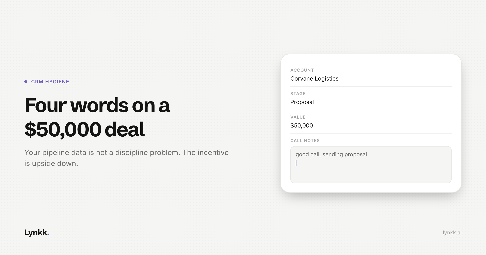

# Your CRM Is a Graveyard of Half-Written Call Notes

<!-- Cover: dark theme, 2400x1260 (2x of 1200x630). Light variant alongside at
     ../images/2026-11-02-crm-graveyard-call-notes/cover-light.png
     On the lynkk.ai blog this file is served from: /images/blog/2026-11-02-crm-graveyard-call-notes/cover.png
     On Medium: upload it as the feature image, then DELETE this image line and this
     comment, or the cover will appear twice. -->

**What this covers:** why the incentive is upside down, what bad notes cost in four specific places, what good looks like, and how to roll a fix out without a mutiny.

---

Open any CRM at a company with more than ten sellers and look at the notes on a deal that closed last quarter. You will find one of four things.

Nothing at all. Three words typed from a phone in a car park. A paste of the calendar invite. Or, at best, a tidy paragraph written four days later, by which point it is not a record of the conversation but a reconstruction of what the rep remembers wanting to have said.

Everyone in sales knows this. It gets treated as a discipline problem, which is why the standard response is a nag: a Friday reminder, a manager checking the field is filled, a rule that a deal cannot change stage without notes.

Those interventions make the data worse, not better. It is worth being precise about why.

## The incentive is upside down

A rep updates the CRM at the end of the day. The cost is theirs: twenty minutes of typing, at the hour they are most tired, about a conversation they already remember.

The benefit goes to someone else. Their manager's forecast, the AE who inherits the account, the CS team at handover, the analyst building the win-loss deck.

When you force the field to be filled, you do not get information. You get whatever is cheapest to type that satisfies the check. **"Good call, sending proposal" passes every audit and contains nothing.**

So your CRM is not a record of what customers said. It is a record of what was cheap enough to write down under time pressure, and everything downstream inherits that.

## What it costs, in four specific places

**The forecast.** Accuracy depends on "verbal commitment" meaning the same thing in two reps' notes. If one writes it when a champion says "this looks good" and another when procurement has a signed order form in review, your pipeline arithmetic is averaging two different quantities. No weighting fixes an error that is in the input.

**Handovers.** A rep leaves and fifteen open deals transfer to someone who must reconstruct six months of relationship from calendar invites and three-word notes. In practice they restart discovery, the customer notices, and some of those deals quietly die of being asked the same questions twice.

**Commitments.** The expensive sentences begin "I'll send you". The security overview, the case study from a team their size, the reference call. Those promises are made verbally, land in no system, and are remembered by the customer long after the rep has forgotten them.

**Multi-threading.** You cannot see that the economic buyer has not spoken on the last three calls if the notes do not record who spoke. The most useful fact about a late-stage deal is the one the notes field is worst at capturing.

## What each pattern is telling you

| Pattern | What it actually means |
|---|---|
| **Empty field** | The rep does not believe anyone reads it. They are usually right, which is why asking harder fails. |
| **Invite paste** | A compliance move. The check passes, nothing is recorded. This is what enforcement without changed economics produces. |
| **Four-day reconstruction** | The dangerous one, because it looks good. Memory reconstructs toward the story the rep is telling themselves, so late notes are systematically more optimistic than the call was. Then they feed the forecast. |
| **The detailed note from your best rep** | Also a problem. It is not repeatable, and you cannot build a forecast on a practice two people in thirty follow. |

## What good looks like

Not longer notes. Different ones. A record worth having answers five questions, findable in seconds:

1. **Who was on the call**, and who actually spoke.
2. **What was decided**, kept separate from what was discussed.
3. **What each side committed to**, with an owner and a date.
4. **What the customer said in their own words** about budget, timeline and the problem. The actual phrasing, because the paraphrase is where optimism gets added.
5. **What changed since last time.** A deal is a sequence, and a note that cannot be compared to the previous one is half useless.

None of those five require the rep's opinion. They are all extraction from what was said, which is why this problem is now solvable in a way it was not five years ago.

## Why automatic capture changes the economics

If notes are produced from the recording, the cost side of the rep's trade-off goes to roughly zero. They are no longer paying twenty tired minutes for someone else's benefit. The record exists because the conversation happened.

That one change does more than any process. It also introduces two new failure modes worth naming before you buy anything.

**A transcript dumped into a CRM field is worse than nothing.** Nobody reads 6,000 words on a deal record. If the output is not structured into decisions, commitments and owners, you have moved the problem and made the record slower to scan.

**Automatic logging without review puts errors into your system of record.** If the AI mishears and writes $50K where the customer said $15K, and that posts unreviewed, you now have a confident wrong number in the forecast. Prefer tools that draft and let a human confirm.

## How to roll it out without a mutiny

- **Do not announce it as a compliance tool.** The moment reps hear "so management can see your calls", adoption dies. Lead with what they get: the follow-up drafted, the promises tracked, the next call's prep already written.
- **Start with handovers and prep**, not the forecast. Those are where the rep feels the benefit in week one.
- **Decide the consent position in writing before you start.** Recording customer calls has requirements that vary by state and country, and "the vendor handles it" is not an answer.
- **Agree what the stages mean** while you are there. Automatic notes make stage definitions the next weakest link, and you will see it immediately.
- **Leave the free-text field.** Automatic capture records what was said, not the rep's read of the room, which is often the most valuable thing they have.

## Where Lynkk fits

I work on Lynkk, so treat this as the vendor's account rather than a review.

Lynkk records Zoom, Google Meet, Microsoft Teams and in-person sales conversations, then writes the notes: a summary, decisions, action items with owners and dates, and a transcript with speakers labelled, where clicking a line plays the call from that moment. The summary and next steps log against the deal in [HubSpot](https://lynkk.ai/integrations/hubspot), [Salesforce](https://lynkk.ai/integrations/salesforce), Pipedrive, Zoho or Attio.

Two design choices speak to the failure modes above. Follow-up emails are **drafted for the rep to send themselves**, and action items reach Jira only when someone presses send. And every call with an account sits together, so "what did they say about budget across our last three calls" returns an answer with the source quote attached.

The limits: CRM setup is done with the Lynkk team rather than self-serve, the free plan caps AI notes at your first 5 hours over the life of the account before Pro at $15 a month, one recording maxes out at two hours, and Lynkk is not end-to-end encrypted, because it has to read a recording to write a note. It does not train AI models on your conversations.

## The takeaway

Your CRM data is not bad because your reps are undisciplined. It is bad because you asked the person with the least time and the least benefit to do the recording, from memory, at the worst hour of their day.

Change who does the recording and the discipline problem mostly disappears. Then you have a better problem: deciding what your pipeline stages actually mean.

---

## Production notes (strip before publishing)

**Skill:** blog-writer (getnao/sylph), applied for Medium.
**Checklist status:** title 50 chars, description 135 chars, no dashes, no banned vocabulary, table used for the patterns, paragraphs within 4 sentences.
**Outstanding:** cover image, author fields, and a human edit adding one real anonymised bad CRM note and the deal it cost. That detail is what separates this from every other post on CRM hygiene.
