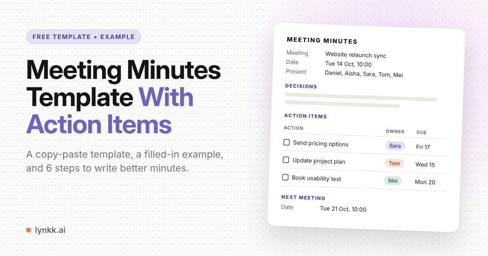
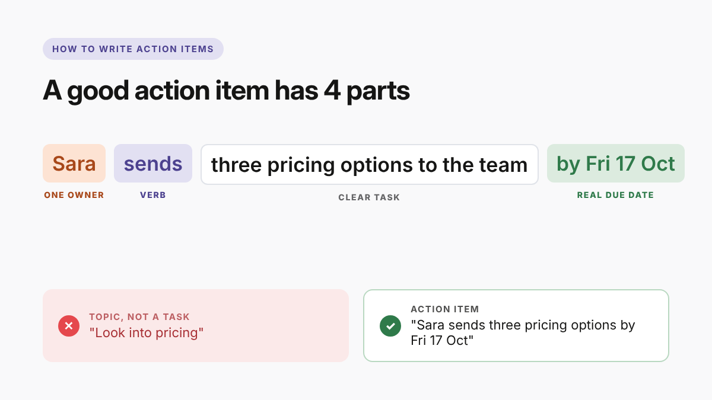

<!--
PLATFORM: Blogger (Blogspot)
Post title / H1 (59 chars): Meeting Minutes Template With Action Items (Free) + Example
Search description (154 chars): Free meeting minutes template with action items, plus a meeting notes template and a filled-in example. Copy it and learn how to write minutes in 6 steps.
Custom permalink: meeting-minutes-template-action-items
Labels: Meeting Minutes, Meeting Notes, Templates, Productivity
Keyword matrix: content/research/keyword-matrix.md (Article 1)
Head keywords: meeting minutes template (22,200), meeting notes template (22,200), meeting minutes (9,900)
Body: meeting minutes sample, meeting minutes example, meeting notes, action items, meeting notes minutes, minutes of meeting
Images (in content/images, sources in content/images/src, re-render with images/render.sh):
  (1) blogger-banner.png, 1200x630: first image in the post, so Blogger uses it as the thumbnail
      and social preview. Alt: "Free meeting minutes template with action items, filled-in example"
  (2) blogger-action-item-anatomy.png, 1200x675: in the action items rules section.
      Alt: "How to write action items: one owner, a verb, a clear task and a real due date"
Guideline notes: keep the two lynkk.ai links as written (descriptive anchors, one section).
Do not bold keywords or add keyword lists. Blogspot in-post links are dofollow.
-->

# Meeting Minutes Template With Action Items (Free) + Example



**Quick answer:** a good meeting minutes template has five parts: the meeting basics (date,
attendees, purpose), key decisions, an action items table where every task has **one owner and one
due date**, open questions, and the next meeting date. Below you'll find a free template you can
copy, a shorter meeting notes template for everyday team meetings, a filled-in example, and the six
steps to write minutes people actually read.

Most minutes fail for one simple reason: they describe the conversation instead of the outcome.
Three days later, nobody remembers who promised what, and the same topic comes back at the next
meeting. Everything in this guide is designed to fix that.

## What are meeting minutes?

Meeting minutes (also called minutes of meeting, or MoM) are the written record of a meeting:
who attended, what was decided, and what happens next. They're sent to attendees and to anyone
who missed the meeting, and they become the reference point when someone later asks "what did we
agree?"

Minutes don't need to capture every sentence. Good minutes capture **decisions** and **action
items**, plus just enough discussion to explain them.

## What are action items in a meeting?

An **action item** is a specific task that someone agreed to do as a result of a meeting. It has a
clear owner, a deadline, and a definition of done. "Look into pricing" is a topic. "Sara sends three
pricing options to the team by Friday" is an action item.

They're the most important part of any minutes, because they're the only part that creates work
after the meeting ends. That's why they get their own table in the template below.

## Meeting notes vs meeting minutes: what's the difference?

| | Meeting notes | Meeting minutes |
|---|---|---|
| Purpose | Help the team remember and act | Official record of what was decided |
| Style | Informal, short, bullet points | Formal, structured, sometimes approved |
| Typical use | Team syncs, project meetings, client calls | Board meetings, committees, associations |
| Action items | Yes, the main focus | Yes, alongside motions and votes |

Rule of thumb: if the record might be read by a board, an auditor or a regulator, write minutes.
For everything else, meeting notes are enough. This post gives you a template for each.

## Free meeting minutes template with action items

Copy this into Google Docs, Word, Notion or an email. It's free to use and edit, and you can delete
any section you don't need.

```
MEETING MINUTES

Organization / team:  [Name]
Meeting:              [Name of meeting]
Date / time:          [Date, start and end time]
Location / link:      [Room or video link]
Chair:                [Name]
Minute taker:         [Name]
Present:              [Names]
Apologies / absent:   [Names]
Purpose:              [One sentence: why did we meet?]

1. APPROVAL OF PREVIOUS MINUTES
   [Approved / approved with changes: list changes]

2. DECISIONS
   2.1 [Decision], proposed by [Name], agreed by [all / vote count]
   2.2 [Decision]

3. ACTION ITEMS
   | # | Action (start with a verb) | Owner | Due date | Status |
   |---|----------------------------|-------|----------|--------|
   | 1 |                            |       |          | Open   |
   | 2 |                            |       |          | Open   |
   | 3 |                            |       |          | Open   |

4. DISCUSSION SUMMARY
   - [Agenda item]: [2-3 lines on what was said and why it matters]

5. OPEN QUESTIONS / PARKING LOT
   - [Question] (raised by [Name])

6. NEXT MEETING
   Date / time: [Date]
   First item: review of action items above

Minutes approved by: ______________   Date: __________
```

## Meeting notes template (short version for team meetings)

For a weekly sync or a client call, the full minutes format is overkill. This shorter meeting notes
template keeps only what your team needs to act on:

```
MEETING NOTES: [Meeting name], [Date]
Attendees: [Names]

Decisions
- [Decision]

Action items
- [ ] [Action] (Owner: [Name], due [Date])
- [ ] [Action] (Owner: [Name], due [Date])

Open questions
- [Question] ([Name])

Next meeting: [Date]
```

It fits in a chat message or an email body, which means people actually read it.

## Meeting minutes example (filled-in sample)

Here's the full template filled in for a real-world style project meeting:

```
MEETING MINUTES

Organization / team:  Marketing
Meeting:              Website relaunch weekly sync
Date / time:          Tuesday 14 October, 10:00 to 10:30
Location / link:      Room 3 + video call
Chair:                Daniel
Minute taker:         Aisha
Present:              Daniel, Aisha, Sara, Tom, Mei
Apologies / absent:   Luis
Purpose:              Agree the launch date and unblock the pricing page.

1. APPROVAL OF PREVIOUS MINUTES
   Approved without changes.

2. DECISIONS
   2.1 Launch moves from 1 November to 8 November to allow one more round
       of testing. Proposed by Tom, agreed by all.
   2.2 Pricing page will show three plans, not four. Proposed by Sara, agreed by all.

3. ACTION ITEMS
   | # | Action                                  | Owner  | Due date   | Status |
   |---|-----------------------------------------|--------|------------|--------|
   | 1 | Send three pricing options to the team  | Sara   | Fri 17 Oct | Open   |
   | 2 | Update launch date in the project plan  | Tom    | Wed 15 Oct | Open   |
   | 3 | Book a usability test with 5 customers  | Mei    | Mon 20 Oct | Open   |
   | 4 | Tell Luis about the new launch date     | Daniel | Today      | Open   |

4. DISCUSSION SUMMARY
   - Testing: QA found 12 bugs on mobile; 9 are fixed. One extra week is
     safer than a rushed launch.
   - Pricing: four plans confused testers in last week's session.

5. OPEN QUESTIONS / PARKING LOT
   - Do we need a separate pricing page for annual billing? (raised by Mei)

6. NEXT MEETING
   Date / time: Tuesday 21 October, 10:00
   First item: review of action items 1 to 4

Minutes approved by: Daniel   Date: 21 October
```

Notice that every action item starts with a verb, has one name next to it, and has a real date.
That's what makes it trackable.

## How to write meeting minutes in 6 steps

If you've never made meeting minutes before, follow these steps in order.

### 1. Prepare the template before the meeting
Fill in the meeting name, date, attendees and purpose in advance. If there's an agenda, add each
agenda item under the discussion section. You'll spend the meeting listening instead of typing
headers.

### 2. Listen for decisions, not dialogue
You don't need to write down who said what. Listen for phrases like "let's go with", "agreed",
"so we'll" and "final answer". Those signal a decision. Write it in one sentence, with who proposed
it if your organization records that.

### 3. Capture action items the moment they're spoken
When someone says "I'll do that" or "can you send...", write it down immediately. If the owner or
date isn't clear, ask right then: *"Who's taking that, and by when?"* This one question is the
biggest single improvement you can make to the quality of your notes.

### 4. Park off-topic questions
Unresolved questions go in the parking lot with the name of the person who raised them. This keeps
the meeting moving and makes sure the question isn't lost.

### 5. Clean up and send within 24 hours
Spend five minutes fixing typos, merging duplicate tasks and checking dates. Then send the minutes
to everyone who attended and everyone who was absent. Minutes sent a week later are rarely read.

### 6. Start the next meeting with the action items
Open the next meeting by going through the previous action items: done, in progress, or blocked.
This creates accountability without anyone having to chase people.

## How to write action items that actually get done



1. **Start with a verb.** "Send", "Book", "Draft", "Review", "Decide". Not "Pricing" or "Website".
2. **One owner per task.** "Marketing team" is not an owner. If two people share it, pick one lead.
3. **A real due date.** "Friday 17 October" beats "next week". "ASAP" is not a date.
4. **Small enough to finish.** If it will take more than a week, break it into smaller steps.
5. **Clear definition of done.** "Draft the email" and "Send the email" are different tasks.
6. **Visible to everyone.** Put tasks in a shared doc or task tool, not in one person's notebook.

## Should you use an AI note taker instead?

Taking good minutes by hand is a skill, and it's hard to do while also taking part in the meeting.
That's why many teams now let an AI meeting assistant handle the note taking.

Tools like [Lynkk](https://lynkk.ai/) join your online meetings (or record in-person ones), and
within about 30 seconds of the meeting ending, produce structured notes with the decisions and
action items already assigned to owners. Lynkk can also create Jira tickets, update your CRM, and
keep every meeting searchable, so the next time someone asks "what did we agree with the client in
March?" the answer takes seconds instead of a search through old emails. You can
[try the Lynkk AI meeting assistant free](https://lynkk.ai/).

Whether you use a tool or the template above, the rules are the same: decisions, owners, dates.

## FAQ

**Should meeting minutes include action items?**
Yes. They're the most useful part of the minutes because they record who will do what after the
meeting. Even formal board minutes usually list actions alongside motions and votes.

**What is the difference between meeting minutes and action items?**
Minutes are the full record of a meeting: attendees, decisions and discussion. Action items are one
section inside the minutes: the list of tasks with owners and due dates.

**What is the best format for meeting minutes with action items?**
Meeting basics at the top, then decisions, then an action items table (task, owner, due date,
status), then a short discussion summary, open questions, and the next meeting date. Decisions and
actions go first because that's what readers look for.

**How do you take good meeting notes if you're also in the meeting?**
Prepare the template in advance, write only decisions and tasks, and ask "who owns that and
by when?" whenever a task comes up. Fill in the discussion summary after the meeting.

**Can meeting minutes be changed after they're sent?**
Yes. Informal notes can be corrected at any time. Formal minutes are normally corrected by approving
amendments at the start of the next meeting, which is why the template has an "approval of previous
minutes" section.

**How soon should minutes be sent?**
Within 24 hours, while everyone still remembers the conversation and before the first deadlines
arrive.

---

*Using ChatGPT, Claude or Copilot to summarize meeting transcripts? Here's the exact prompt (and a
script that turns the to-dos into Jira tickets):
[AI Meeting Notes From Any Transcript: The Prompt + a Jira Script](HASHNODE_POST_URL).*
