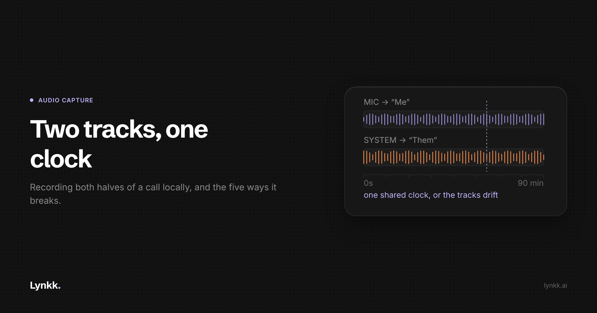

# Recording Both Sides of a Call Without Putting a Bot in the Room

<!-- Cover: dark theme, 2400x1260 (2x of 1200x630). Light variant at
     images/H1-recording-both-sides-without-a-bot/cover-light.png
     Hashnode: upload as the post cover, then delete this image line and comment.
     Substack/LinkedIn: upload as the header image, same. -->

Most meeting assistants join your call as a participant. There is a good engineering reason for
that, and there is a real alternative. This is about the alternative: capturing both halves of a
conversation locally, why it is harder than it sounds, and the specific places it goes wrong.

This post is about the local capture path.

## Why bots exist, stated fairly

When a bot joins a Zoom or Meet call, the platform hands it a media stream. Depending on the API,
that can mean separate audio tracks per participant. If you have per-participant tracks, speaker
attribution is nearly free: you do not need to cluster voices acoustically, you just read the
track labels.

A bot also decouples capture from any particular device. It can record a call the user joined from
their phone, or a call they never joined at all.

Those two properties are why most of the category went this way. Any local approach gives up both.

## What local capture has to solve

To record a call on the user's own machine you need two audio sources at once:

1. **The microphone**, which is the local person.
2. **System audio output**, which is everybody else, already mixed by the conferencing app.

And you need them **time-aligned**, because everything downstream (diarization, summarisation,
"who committed to what") depends on knowing the order in which things were said.

The naive implementation records a single mixed stream containing both. Do not do this. You throw
away the one piece of speaker information you get for free.

## Design decision one: two tracks, not one

Keep the microphone and the system output as separate tracks for as long as you can, ideally all
the way to the transcription stage.

The reason is that this gives you a guaranteed two-way split at zero cost: everything on the mic
track is the local user, everything on the system track is the far side. That is not full
diarization, but it is the single most useful cut, and it is exactly the distinction that matters
for commitment extraction. "I'll send you the security overview" means something completely
different depending on which side said it.

Lynkk's product language reflects this directly: the mic is "Me" and the call is "Them". That is
not a UI flourish, it is the data model surfacing.

You still need acoustic diarization **within** the system track, because three people on the far
side arrive on one channel. But the problem is now meaningfully smaller.

## Design decision two: the capture API, and the permission wall

On macOS, capturing system audio has historically required a virtual audio device, a kernel
extension or a user-installed loopback driver. Modern macOS exposes system audio capture through
ScreenCaptureKit, which is the sanctioned route and avoids shipping a driver, at the cost of
requiring screen-recording permission. That permission prompt is a real product problem: you are
asking for "screen recording" in order to capture audio, and users reasonably find that alarming.

> **[ENGINEER INPUT REQUIRED]** Which API does the Lynkk Mac app actually use, and what is the
> permission copy? This section needs the real implementation and the real prompt text, plus the
> minimum supported macOS version. I have described the general approaches, not our build, and I am
> not going to guess at our own code.

Three constraints fall out of whichever route you take:

- **Sample-rate mismatch.** The mic and the system output can run at different rates and in
  different formats. You need an explicit resample and a defined canonical format rather than
  whatever each source hands you.
- **Drift.** Two independent capture clocks diverge over an hour. If you concatenate buffers
  assuming they are in lockstep, your two tracks desynchronise, and a transcript where the far
  side's replies precede the questions is worse than no transcript. Timestamp from a common clock
  and resample against it.
- **Device changes mid-session.** The user plugs in headphones forty minutes in. Your capture graph
  must survive a default-device change without ending the recording, which is the single most
  common cause of truncated sessions in local capture.

## Design decision three: buffer to disk, not memory

Record straight to disk in chunks. An hour of two-track audio is not large, but holding it in
memory means a crash loses the session, and sessions are irreplaceable: the meeting happened once.

This also gives you offline capture almost for free. If the file is already on disk, uploading
later is an independent concern, which is what makes recording with no network connection
possible. Then you need:

- **A durable upload queue** that survives app restart and machine sleep.
- **Resumable uploads**, because a 2 hour recording over a hotel connection will not complete in
  one attempt.
- **A local retention policy**, so the device copy is not kept forever. Lynkk's is 7 days after
  upload.

> **[ENGINEER INPUT REQUIRED]** Our chunk size, container format, and the upload queue's retry
> and resume behaviour. Also what happens on disk-full mid-recording, which is a real failure mode
> for long field sessions and worth documenting honestly.

## The five failure modes, in order of how often they bite

**1. The lid closes.** The machine sleeps, capture stops, and the user does not find out until
afterwards. You need an explicit decision here: prevent sleep while recording, or fail loudly.
Silently stopping is the worst option and the default one.

**2. Default-device change.** Covered above. Test it: start recording, plug in AirPods, keep
talking, check the file.

**3. Clock drift over long sessions.** Mostly invisible in a ten-minute test, obvious at ninety
minutes. Test with a long recording and a hard sync marker.

**4. The far side is one channel.** Three people on a conference-room speaker arrive mixed and
room-reverberant. Acoustic diarization quality here is the main quality difference between local
capture and bot capture, and it is worth measuring rather than assuming.

**5. Nothing announces the recording.** This is not an engineering failure, it is the engineering
consequence of removing the bot. With a bot, the participant list does a thin kind of disclosure.
With local capture there is nothing, so the product has to make the user do it. Build the consent
prompt into the start-recording flow rather than treating it as a docs problem.

## What you cannot fix

Be clear with users about the irreducible limits rather than discovering them in support tickets:

- No device present, no recording. Phone-joined calls are not covered.
- You cannot record a meeting the user is not attending. This is a genuine reason to keep a bot
  path alongside local capture, and why Lynkk ships both rather than treating bot-free as a
  principle.
- Typically no video.
- Sustained CPU and battery cost for the whole session.

## Testing it properly

A test matrix that would have caught every bug I have seen in this area:

| Case | What it catches |
|---|---|
| 90+ minute recording with a sync marker at start and end | Clock drift |
| Switch output device mid-recording | Capture graph fragility |
| Close lid / let machine sleep | Silent termination |
| Record with network off, then reconnect | Upload queue durability |
| Three far-side speakers on one room mic | Diarization quality floor |
| Kill the app mid-recording | Disk buffering, recovery |
| Fill the disk mid-recording | Graceful failure |
| Two different sample rates on mic vs system | Resampling path |

Automate the first four. They are the ones that silently lose a user's meeting, and a lost meeting
is the only unrecoverable bug in this product category.

## Why it is worth the trouble

Technically, the bot is easier. But there are calls where an extra participant appearing in the
list is the wrong thing: external calls, customers whose IT blocks unknown participants, and
every in-person conversation, where there is no call to join at all.

Lynkk's [Chrome extension](https://lynkk.ai/features/chrome-extension) takes the no-bot route for
browser calls, and the Mac app handles local and in-person capture. Both exist because neither
model covers every meeting.

---

## Publishing notes

**Hashnode compliance (see `content/platform-compliance.md`):** one commercial link only, which is
the ceiling the Code of Conduct effectively sets for promotional linking. Do not bulk-publish this
alongside H2, H3 and H4; space them out by at least a week each.

**This post cannot publish as drafted.** Hashnode's Code of Conduct prohibits "using the platform
primarily for self-promotion without contributing to the community". The contribution here is the
implementation detail, and the two `[ENGINEER INPUT REQUIRED]` blocks are where it comes from. An
engineer who built the Mac capture path needs to fill those in with real API choices, real code and
real failure data. Without that this is a plausible-sounding essay about audio capture, which is
exactly the kind of post Hashnode's spam detection and its readers both punish.
