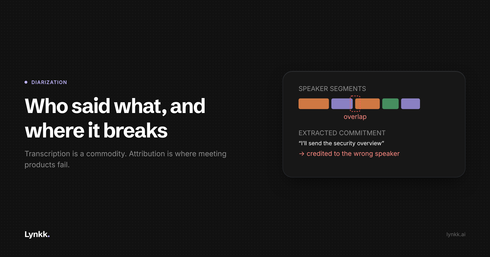

# Speaker Diarization in Production: Five Ways "Who Said What" Breaks

<!-- Cover: dark theme, 2400x1260 (2x of 1200x630). Light variant at
     images/H2-speaker-diarization-in-production/cover-light.png
     Hashnode: upload as the post cover, then delete this image line and comment.
     Substack/LinkedIn: upload as the header image, same. -->

Transcription is mostly a solved problem. Attribution is not.

Getting words out of audio is now a commodity. Getting the right name in front of each line, and
keeping it right for ninety minutes, across overlapping speech, on one microphone in a room, is
where meeting products actually fail. This is about the five failures that matter in production
and how to measure them.

## The pipeline, briefly

A typical diarization pipeline does four things:

1. **Voice activity detection**: find the speech regions.
2. **Segmentation**: cut the speech into segments likely to contain one speaker.
3. **Embedding**: turn each segment into a speaker vector.
4. **Clustering**: group the vectors, so each cluster is a speaker.

Then you align the clusters against the ASR output to label lines.

Two things about this architecture cause most production pain. **It is unsupervised at the point
where it matters**, so the number of speakers is usually inferred rather than known. And **it
treats speech as a sequence of single-speaker segments**, which real conversation is not.

## Failure 1: the speaker count is wrong

Clustering has to decide how many speakers exist. Get it wrong and the output is wrong in a
specifically unhelpful way: two people merged into one cluster, so a commitment made by the
customer is attributed to your own rep, or one person split into two, so a single speaker appears
as "Speaker 2" and "Speaker 4" and no downstream summary can reason about them.

Over-splitting is loud and users report it. Under-splitting is quiet and dangerous, because the
transcript looks clean and is wrong.

**What helps in practice:** if you have any external signal for the speaker count, use it instead
of inferring. A calendar invite has attendees. A conferencing API may expose participants. A
two-track local recording already tells you the mic side is one person. Treating the count as
known whenever you can know it removes an entire class of error.

## Failure 2: overlapping speech

Standard pipelines assign one speaker per segment. In real meetings people talk over each other
constantly: agreement noises, interruptions, the half-second where one person starts before the
other finishes.

Published diarization error rates are usually quoted on corpora where overlap is a small fraction
of the audio. Real sales calls and especially real in-person meetings have far more. Overlap is
where the error concentrates, and it concentrates at conversational turn boundaries, which is
exactly where the semantically important content sits: the answer to a question, the reaction to a
price.

**What helps:** overlap-aware diarization rather than single-label segmentation, and separately,
not pretending to attribute an overlapped region. A transcript line marked as uncertain is more
useful than a confident wrong name.

## Failure 3: one microphone in a room

This is the big asymmetry. With per-participant audio streams from a conferencing platform,
attribution is nearly free. With a single microphone in a room you must do it acoustically, with:

- **Reverberation** smearing the spectral cues the embeddings rely on.
- **Variable distance**, so the same speaker's embedding shifts depending on whether they leaned
  in or sat back.
- **Non-stationary noise**: air conditioning, traffic, cutlery, chairs.

Distance is the underrated one. A speaker's embedding is not distance-invariant, so the person at
the far end of the table can cluster separately from themselves after they move.

**What helps:** explicitly asking the user to say names in the first thirty seconds, which gives
you labelled enrolment samples at no engineering cost. "Thanks for joining, Priya, and you brought
Neha from IT" is a free labelled dataset for that session, and it is also just good meeting
practice.

## Failure 4: re-identification across sessions

Within a meeting, "Speaker 1" is enough to be useful. Across meetings it is not, and account-level
memory requires knowing that the Priya in October is the Priya from March.

This is a harder problem than within-session clustering. Voices vary with health, mood, device and
connection quality. A threshold loose enough to match the same person across six months will also
merge two different people with similar voices, and in a sales context merging two people at the
same customer is a serious error: you will attribute a commitment to the wrong person and surface
it to your own rep as fact.

**What helps:** do not do this silently. Treat cross-session identity as a suggestion requiring
confirmation, and let a user confirm "this is Priya" once, which converts an unsupervised problem
into a supervised one with a single click.

> **[ENGINEER INPUT REQUIRED]** How Lynkk actually handles cross-session speaker identity, if at
> all, and whether confirmation is surfaced to the user. I am not going to describe our approach
> without knowing it.

## Failure 5: code-switching

This is where published benchmarks tell you almost nothing, and where our market lives.

Indian business conversation moves between Hindi and English inside a single sentence. Two separate
things break:

**ASR language identification.** Many pipelines detect the language of a chunk, then run the
matching acoustic model. That design cannot express a sentence that is 60% Hindi and 40% English,
so whatever it picks is wrong for part of the audio. The output is half-plausible English and half
phonetic mush.

**Diarization embeddings under language switching.** Speaker embeddings are trained on particular
distributions of phonetic content. A speaker switching language mid-utterance shifts that content
substantially, and embedding stability can suffer.

The downstream consequence is the one that matters commercially: **action items are extracted from
the mangled text.** A commitment stated in Hindi can simply vanish from the summary while the
transcript still looks mostly fine. The failure is invisible at the transcript level and total at
the product level.

Lynkk ships a [Hinglish mode](https://lynkk.ai/features/hinglish-transcription) for this.

> **[ENGINEER INPUT REQUIRED]** What the Hinglish path actually does differently: a
> code-switching-capable model, a different decoding strategy, something else? And our measured
> performance on mixed-language audio versus monolingual. This is the most valuable section in the
> post and I can only frame the problem, not report our solution.

## Measuring it, so you can tell if you improved anything

**Diarization error rate (DER)** is the standard metric: missed speech, false alarm speech, and
speaker confusion, over total speech time. Use it, but know its weaknesses for this application:

- It is **duration-weighted**, so short utterances contribute almost nothing. But "yes, approved"
  is three words and the most important moment on the call. DER can improve while your product
  gets worse.
- Standard scoring often applies a **forgiveness collar** around boundaries and may exclude
  overlapped regions, which are precisely the regions where your users notice errors.

**What I would track alongside DER:**

- **Attribution accuracy on extracted action items.** The product-level metric. Did the right
  person get credited with each commitment?
- **Speaker-count accuracy**, reported separately. It is a different failure with a different fix.
- **Label stability over session length.** Measure DER in the first ten minutes versus the last
  ten of a ninety-minute recording. Drift is invisible in short tests.
- **A code-switching slice**, scored separately from your English set, or you will average away
  the thing your users care about most.

> **[ENGINEER INPUT REQUIRED]** Our actual numbers on all of the above, and the composition of our
> eval set. A Hashnode post about production diarization with no measurements is a blog post about
> reading papers. **Note: there is no published accuracy figure anywhere on lynkk.ai, and the
> "97% accuracy" line that appears in our Ubersuggest project summary is unsourced. Do not put it
> in this post. Get a real measured number or publish none.**

## The summary

Transcription accuracy is table stakes. Attribution is the differentiator, and it breaks in five
specific places: speaker count, overlap, single-microphone rooms, cross-session identity, and
code-switching. Four of the five are worse in person than on a call, which is why in-person meeting
support is a genuinely different engineering problem rather than a checkbox.

---

## Publishing notes

**Hashnode compliance:** one commercial link. Space publication at least a week from H1, H3 and H4.

**Do not publish without the engineer input blocks filled.** Hashnode requires contribution rather
than self-promotion, and the contribution in this post is the measurements. Three blocks need real
data. Explicitly: **no accuracy percentage may be published unless it is measured and someone will
stand behind the methodology.**
