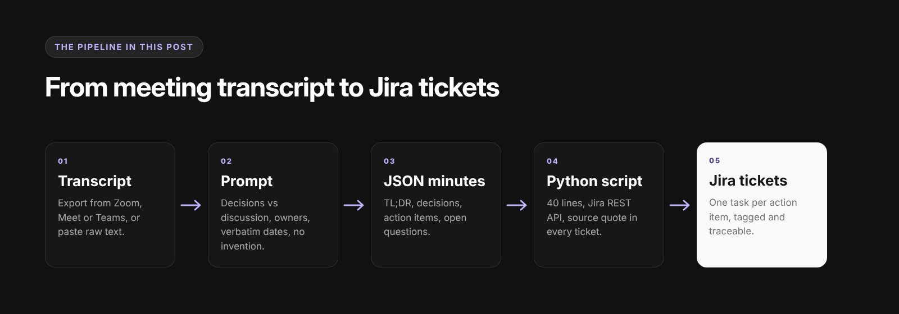

<!--
PLATFORM: Hashnode
Title / H1: AI Meeting Notes From Any Transcript: The Prompt + a Jira Script
Subtitle (Hashnode field): A copy-paste prompt for ChatGPT, Claude and Copilot that turns a meeting transcript into minutes, decisions and action items, plus 40 lines of Python that file them in Jira.
SEO title (56 chars): AI Meeting Notes: The Prompt to Summarize Any Transcript
SEO description (152 chars): Get AI meeting notes from any transcript: one prompt for ChatGPT, Claude or Copilot that writes minutes and action items, plus a Python script for Jira.
Slug: ai-meeting-notes-transcript-prompt
Tags (max 5): ai, llm, productivity, python, jira
Keyword matrix: content/research/keyword-matrix.md (Article 2)
Head keywords: ai meeting notes (1,000), ai meeting minutes (1,600), ai note taker (27,100, one natural mention)
Body / long-tail: summarize meeting, meeting summary, chatgpt meeting notes, prompt to summarize meeting transcript (+ ChatGPT / Claude / Copilot variants)
Images (in content/images, sources in content/images/src, re-render with images/render.sh):
  Cover: hashnode-cover.png, 1600x840 (Hashnode's recommended cover size). Upload via "Add cover",
    not inside the body. Alt: "AI meeting notes from any transcript: prompt, JSON and Jira ticket"
  Inline: hashnode-pipeline.png, 1600x560, after the intro.
    Alt: "Pipeline from meeting transcript to prompt, JSON minutes, Python script and Jira tickets"
Guideline notes (Hashnode Code of Conduct): value first, one product mention near the end, no
keyword lists, review the post yourself before publishing. Hashnode outbound links are nofollow;
the Lynkk link is for readers and brand mentions, not PageRank.
-->

# AI Meeting Notes From Any Transcript: The Prompt + a Jira Script

**Short answer:** you can get solid AI meeting notes from any transcript with one well-built prompt.
The prompt that works best tells the model *who* the meeting summary is for, forces it to separate
**decisions** from **discussion**, makes every action item carry an **owner and a due date**, and
bans it from inventing anything that isn't in the transcript. Ask for JSON and you can pipe the
action items straight into Jira. The full prompt is below; copy it, paste your transcript, done.

I've tested a lot of "summarize this meeting" prompts on real engineering standups, sprint
plannings and customer calls. Most of them fail in the same three ways, so let's start there.



## Why "summarize this transcript" gives you useless notes

Paste a 45-minute transcript into any LLM with a one-line instruction and you'll get:

1. **A narrative recap.** "The team discussed the release timeline and various concerns were
   raised." Nobody needs that. You need *what was decided* and *who does what by when*.
2. **Orphaned action items.** "Follow up with the design team." Who follows up? By when? An
   action item without an owner is a wish.
3. **Confident hallucinations.** If the transcript says "let's aim for the end of the month", a
   lazy prompt produces "Deadline: October 31" and nobody notices until the 31st.

A good meeting summary prompt fixes all three with explicit structure and explicit rules.

## The prompt (works in ChatGPT, Claude, Gemini and Copilot)

Copy this as-is. Replace the two bracketed lines.

```text
You are an expert meeting secretary for a software team.

CONTEXT
- Meeting type: [e.g. sprint planning / customer call / weekly sync]
- Audience for this summary: people who missed the meeting and need to act on it.

TASK
Read the transcript below and produce meeting minutes with these sections, in this order:

1. TL;DR: 2-3 sentences. What changed because this meeting happened?
2. Decisions: a numbered list. Only things the group clearly agreed on.
   Quote the deciding sentence in brackets after each one.
3. Action items: a table with columns
   | # | Task (starts with a verb) | Owner | Due date | Source quote |
4. Open questions: things raised but not resolved, and who raised them.
5. Risks / blockers mentioned.

RULES
- Use only information in the transcript. Never invent names, dates, numbers or tasks.
- If an action item has no clear owner, write "UNASSIGNED".
- If a due date is vague ("next week", "end of month"), copy the exact phrase. Do not convert it to a date.
- Separate what was DECIDED from what was only DISCUSSED. If unsure, put it in Open questions.
- Keep each action item to one line. Merge duplicates.
- Write in the same language the meeting was held in.

TRANSCRIPT
"""
[paste transcript here]
"""
```

### Why each line is there

| Instruction | What it prevents |
|---|---|
| "Audience: people who missed the meeting" | Narrative recaps; forces actionable output |
| Decisions *with a source quote* | Turning a suggestion into a "decision"; lets you verify in seconds |
| "Task starts with a verb" | Vague items like "design team" instead of "Send mockups to design team" |
| `UNASSIGNED` | The model guessing an owner from whoever spoke last |
| Copy vague dates verbatim | Fake deadlines |
| "Same language as the meeting" | Silent translation of multilingual calls |

## Model-specific tweaks

The prompt above is portable, but each assistant has quirks.

### ChatGPT meeting notes prompt

ChatGPT tends to over-format. Add `Do not use emojis or bold text inside the table.` If the
transcript is very long, upload it as a `.txt` file instead of pasting so it isn't truncated. The
same prompt works if you call your output "ChatGPT meeting minutes" rather than notes; the
sections don't change.

### Claude prompt to summarize a meeting transcript

Claude follows structure well and respects the "never invent" rule. Wrapping the transcript in
`<transcript>...</transcript>` tags instead of triple quotes makes the boundary even clearer on
very long inputs.

### Copilot prompt to summarize a meeting transcript (Teams)

Inside Teams, Copilot already has the transcript, so drop the TRANSCRIPT block and start with:
`Using the transcript of this meeting, produce minutes with the following sections...`
Copilot answers are shorter by default, so add `Include every action item, even minor ones.`

## Get AI meeting minutes as JSON (for automation)

Markdown minutes are great for humans. For tools, ask for JSON. Replace the TASK section with this:

```text
Return ONLY valid JSON matching this schema. No prose before or after.

{
  "tldr": "string",
  "decisions": [{ "text": "string", "quote": "string" }],
  "action_items": [{
    "task": "string, starts with a verb",
    "owner": "string or UNASSIGNED",
    "due": "string exactly as spoken, or null",
    "priority": "high | medium | low",
    "quote": "string"
  }],
  "open_questions": [{ "text": "string", "raised_by": "string" }]
}
```

Example output from a 30-minute sprint planning:

```json
{
  "tldr": "Search reindex moves to sprint 42; the billing bug ships as a hotfix first.",
  "decisions": [
    { "text": "Ship the billing rounding fix as a hotfix before the sprint starts",
      "quote": "Okay, hotfix it Thursday, nobody wants to wait two weeks on billing." }
  ],
  "action_items": [
    { "task": "Write a regression test for the rounding bug", "owner": "Priya",
      "due": "before Thursday", "priority": "high",
      "quote": "Priya, can you get a test around that before Thursday?" },
    { "task": "Estimate the search reindex job", "owner": "UNASSIGNED",
      "due": null, "priority": "medium",
      "quote": "Someone needs to size the reindex." }
  ],
  "open_questions": [
    { "text": "Do we need a migration window for the reindex?", "raised_by": "Marco" }
  ]
}
```

Notice `"owner": "UNASSIGNED"` and `"due": null`. That's the prompt doing its job: it refused to
guess.

## From meeting notes to Jira tickets in 40 lines of Python

Once you have JSON, filing tickets is plumbing. This script reads the JSON above and creates one
Jira task per action item using the Jira Cloud REST API (v2, which accepts a plain-text
description). Create an API token at id.atlassian.com first.

```python
import json
import os
import sys

import requests

JIRA_URL = os.environ["JIRA_URL"]          # e.g. https://yourteam.atlassian.net
JIRA_EMAIL = os.environ["JIRA_EMAIL"]
JIRA_TOKEN = os.environ["JIRA_API_TOKEN"]
PROJECT_KEY = os.environ.get("JIRA_PROJECT", "ENG")


def create_issue(item: dict, meeting: str) -> str:
    description = (
        f"From meeting: {meeting}\n"
        f"Owner (from transcript): {item['owner']}\n"
        f"Due (as spoken): {item['due'] or 'not stated'}\n\n"
        f"Source quote:\n{{quote}}{item['quote']}{{quote}}"
    )
    payload = {
        "fields": {
            "project": {"key": PROJECT_KEY},
            "summary": item["task"],
            "description": description,
            "issuetype": {"name": "Task"},
            "labels": ["from-meeting", f"priority-{item['priority']}"],
        }
    }
    resp = requests.post(
        f"{JIRA_URL}/rest/api/2/issue",
        json=payload,
        auth=(JIRA_EMAIL, JIRA_TOKEN),
        timeout=30,
    )
    resp.raise_for_status()
    return resp.json()["key"]


if __name__ == "__main__":
    path, meeting_name = sys.argv[1], sys.argv[2]
    with open(path) as f:
        minutes = json.load(f)
    for item in minutes["action_items"]:
        key = create_issue(item, meeting_name)
        print(f"{key}: {item['task']} ({item['owner']})")
```

Run it:

```bash
export JIRA_URL=https://yourteam.atlassian.net JIRA_EMAIL=you@company.com JIRA_API_TOKEN=...
python file_tickets.py minutes.json "Sprint 42 planning"
```

A few design choices worth copying:

- **The source quote goes into the ticket.** Whoever picks it up can see exactly what was said,
  which kills the "that's not what we agreed" conversation.
- **Owner goes in the description, not the assignee field.** Jira assignees need account IDs, and
  mapping "Priya" to an account ID is where these scripts usually break. Add the mapping later
  once the basics work.
- **Everything gets a `from-meeting` label**, so you can build a Jira filter of all meeting-born
  work and see how much of it actually gets done.

## Prompt vs AI note taker: where DIY stops scaling

This prompt + script combo is genuinely useful for a handful of meetings a week, and it costs
nothing beyond the LLM you already use. It starts to hurt when:

- **You have to get the transcript first.** Someone has to record, export and paste every time.
- **Context lives in previous meetings.** "As we agreed last Tuesday" means nothing to a model
  that only sees today's transcript.
- **Half your meetings aren't on Zoom.** In-person conversations and hallway decisions never get
  transcribed at all.
- **You want to ask questions later.** "When did we decide to drop SSO from v1?" requires searching
  across *all* meetings, not summarizing one.

That's the gap a dedicated AI note taker fills. For example, [Lynkk](https://lynkk.ai/) records online and
in-person meetings, produces structured notes and assigned action items within about 30 seconds
of the call ending, creates the Jira tickets for you, and keeps every meeting in a searchable
knowledge graph so the "last Tuesday" context is there before the next call starts. If you'd
rather keep full control, the prompt and script above are a solid way to get 80% of the way.

## FAQ

**What is the best prompt to summarize a meeting transcript?**
One that defines the audience, separates decisions from discussion, requires an owner and due date
for every action item, and forbids inventing details. The template at the top of this post does
all four.

**What should an AI meeting summary include?**
A two or three sentence TL;DR, the decisions made, action items with owners and due dates, open
questions, and risks. Anything else is optional and usually skipped by readers.

**Can ChatGPT summarize a meeting transcript for free?**
Yes. Paste the transcript (or upload it as a text file) with the prompt above. Very long transcripts
may exceed the free tier's context window; split them by agenda item if that happens.

**How do I turn a meeting transcript into minutes?**
Use a prompt with fixed sections (TL;DR, decisions, action items, open questions, risks), require a
source quote for each decision, and review the action item table before sending it.

**How do I get Copilot to summarize a Teams meeting transcript?**
Turn on transcription in the meeting, then open Copilot in the meeting chat or recap and use the
Copilot version of the prompt above, which skips the TRANSCRIPT block.

**How do I create Jira tickets from meeting notes automatically?**
Ask the model for JSON action items, then post each one to the Jira REST API (`/rest/api/2/issue`),
as in the Python script above. AI meeting assistants such as Lynkk do this step without code.

---

*Prefer to write the minutes yourself? Here's a free copy-paste version with a filled-in example:
[Meeting Minutes Template With Action Items (Free) + Example](BLOGGER_POST_URL).*
