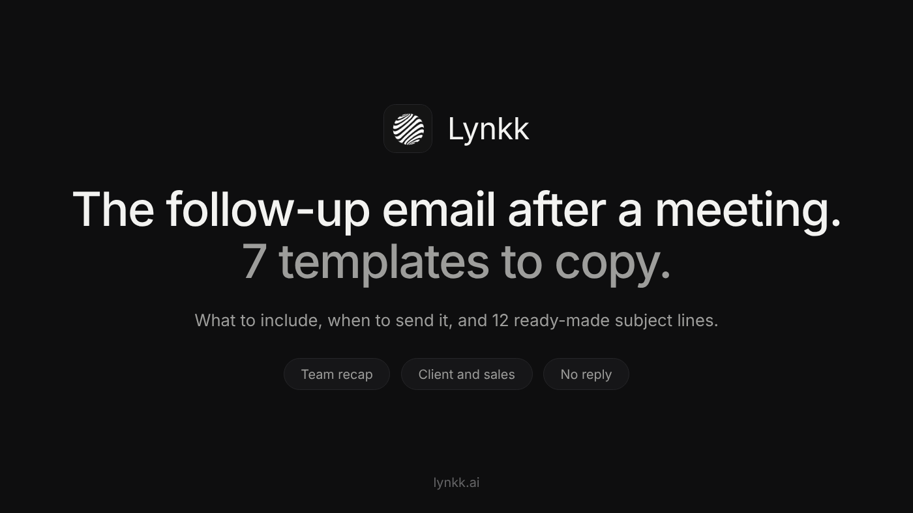
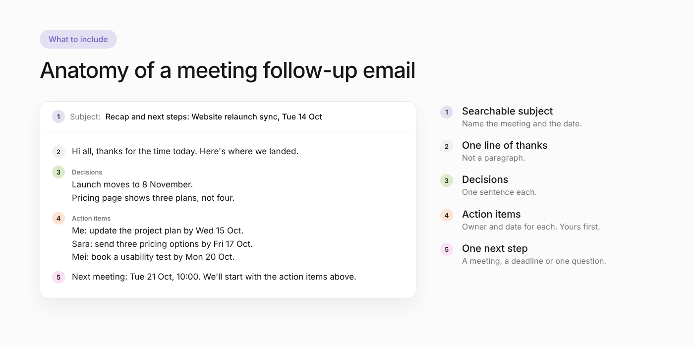

<!--
PLATFORM: Medium (third story)
Title (H1): How to Write a Follow-Up Email After a Meeting
Subtitle: What to include, when to send it, 12 subject lines, and 7 copy-paste templates for your team, clients, sales calls and no-replies.
SEO title (52 chars): Follow-Up Email After a Meeting: 7 Templates to Copy
SEO description (150 chars): How to write a follow-up email after a meeting: what to include, when to send it, 12 subject lines, and 7 copy-paste templates with action items.
Custom story link: follow-up-email-after-meeting
Tags (max 5): Productivity, Email, Sales, Business, Communication
Canonical: none (original story)
Keyword matrix: content/research/keyword-matrix.md (Article 6)
Topic research (Ubersuggest Google autocomplete, US, 2026-10-16; volumes pending, daily report limit reached):
  meeting follow up email template / example / subject line / format / with action items,
  follow up email after meeting with client, sales meeting follow up email, follow up email after
  meeting no response, follow up email when someone misses a meeting, when to send follow up email
  after meeting, what should a follow up meeting email include, write a follow up email using my
  meeting notes, follow up email after one on one meeting
Content research (2026-10-16): page one is thin template pages (several auto-generated) and
email/sales vendor blogs; no Medium story. Gap: situation-specific templates that carry action items.
Images (content/images, sources in content/images/src):
  Featured: medium3-banner.png, 1400x788. Alt: "How to write a follow-up email after a meeting, with 7 templates"
  Inline: medium3-email-anatomy.png, 1400x700.
    Alt: "Anatomy of a meeting follow-up email: subject, thanks, decisions, action items, next step"
Medium formatting: no tables, 2 heading levels, code fences become plain lines in the Word/HTML exports.
-->

# How to Write a Follow-Up Email After a Meeting

A good meeting can still go nowhere. Everyone leaves agreeing on next steps, and a week later nobody remembers exactly what those steps were, who owned them, or when they were due.

The follow-up email is what turns a conversation into progress. It takes five minutes to write, and it's the difference between "I thought you were sending that" and work actually getting done.

**The short answer:** send your follow-up email within 24 hours of the meeting. Keep it short: one line of thanks, the decisions that were made, the action items with an owner and a date for each (yours first), and one clear next step. Use a subject line that names the meeting so it's easy to find later.

Below: what to include, when to send it, 12 subject lines, and 7 templates you can copy for different situations.

## What to include in a meeting follow-up email

Every good follow-up email has the same five parts:

1. **A subject line people can search for later.** Name the meeting and the date.
2. **One line of thanks.** Not a paragraph. "Thanks for the time today" is enough.
3. **What was decided.** One sentence per decision. This is the part people forward to their boss.
4. **Action items, with owners and dates.** Put *your* action items first. It shows you're on it and makes it easier to ask others for theirs.
5. **One clear next step.** The next meeting, a deadline, or a single question you need answered.

Optional: the attachment you promised, a link to the recording, or open questions that still need an answer.

What to leave out: a minute-by-minute recap of the conversation. If someone wants the full detail, link the notes.

## When to send it

**Same day is best, within 24 hours at the latest.** The details are fresh for everyone, including you, and the first deadlines usually come quickly.

If the follow-up gets no reply, wait about **3 to 5 business days** before nudging once. If there's still no reply after a second nudge, change the channel (a quick call or chat message) instead of sending a third email.

## 12 follow-up email subject lines

Clear beats clever. These all tell the reader exactly what's inside:

- Recap and next steps: [Meeting name], [date]
- Notes from today's [project] sync
- Following up on our call about [topic]
- Action items from [meeting name]
- Great meeting today: next steps for [company]
- [Company] + [Your company]: recap and proposal
- Recap of our 1:1 on [date]
- You missed [meeting]: here's what was decided
- Quick recap from our call
- Next steps after our demo
- Checking in on [action item] from our meeting
- Confirming our next meeting on [date]

## 7 follow-up email templates

Replace everything in brackets. Delete any line that doesn't apply.

### 1. Team meeting recap with action items

Use this after internal meetings: syncs, planning sessions, project check-ins.

**Subject:** Recap and next steps: Website relaunch sync, Tue 14 Oct

Hi all,

Thanks for the time today. Here's where we landed.

**Decisions**

- Launch moves to 8 November to allow one more round of testing.
- The pricing page will show three plans, not four.

**Action items**

- Me: update the project plan with the new date by Wed 15 Oct.
- Sara: send three pricing options by Fri 17 Oct.
- Mei: book a usability test with 5 customers by Mon 20 Oct.

Next meeting: Tue 21 Oct, 10:00. We'll start with the action items above.

Thanks, [Your name]

### 2. Client meeting follow-up

Use this after a check-in, review or planning call with a client.

**Subject:** Recap: [Client] onboarding check-in, [date]

Hi [Name],

Thanks for walking us through where things stand today. A quick recap so we're aligned:

**What we agreed**

- Training will run as two smaller sessions instead of one.
- We'll record short videos for the admin setup.

**Next steps**

- [Your company]: send the revised onboarding plan by [date].
- [Your company]: share the 3 admin setup videos by [date].
- [Client]: confirm budget for the extra seats by [date].

Still open: the SSO login issue for EU users. We're on it and will update you by [date].

If I've missed anything, just reply here and I'll update the plan.

Best, [Your name]

### 3. Sales call or demo follow-up

Use this after a discovery call or product demo. Lead with *their* problem, not your product.

**Subject:** Next steps after our demo, [Company]

Hi [Name],

Thanks for the conversation today. What stood out to me was [their main challenge, in their words].

**What we covered**

- How [feature] handles [their use case].
- Pricing for a team of [number].

As promised, I've attached [case study / pricing / security overview].

**Next steps**

- I'll send a proposal by [date].
- Could you share it with [decision maker] before our next call?

Does [day, time] work for a 20-minute follow-up?

Best, [Your name]

### 4. After a first meeting or networking conversation

Short, specific and easy to reply to.

**Subject:** Great to meet you at [event]

Hi [Name],

It was great meeting you at [event] and hearing about [specific thing they mentioned].

As promised, here's [the article / intro / resource] we talked about: [link].

If it's useful, I'd be glad to continue the conversation over a 20-minute call in the next couple of weeks.

Best, [Your name]

### 5. One-on-one meeting recap with your manager

Sending the recap yourself makes sure you and your manager remember the same conversation.

**Subject:** Recap of our 1:1 on [date]

Hi [Manager],

Thanks for the time today. Here's my summary:

- Priorities for the next two weeks: [priority 1], [priority 2].
- You'll check with [person] about [blocker] by [date].
- I'll share a draft of [deliverable] by [date].

Let me know if I've got anything wrong.

Thanks, [Your name]

### 6. For someone who missed the meeting

Don't make them watch the recording to find out what they owe.

**Subject:** You missed [meeting]: here's what was decided

Hi [Name],

Sorry you couldn't make it today. The short version:

- [Decision 1]
- [Decision 2]

One action item is yours: [task] by [date]. Does that work for you?

Full notes and the recording are here: [link].

Thanks, [Your name]

### 7. When your follow-up gets no reply

Send this 3 to 5 business days after the first follow-up. Make it easy to answer with one line.

**Subject:** Re: Recap and next steps: [Meeting name]

Hi [Name],

Just bumping this up in case it got buried. The one thing I need from you is [specific question or decision].

If it's easier, a quick yes or no is fine.

Thanks, [Your name]

## Common mistakes

- **Sending it days later.** By then, people have moved on and the deadlines have already slipped.
- **Action items with no owner.** "Follow up with legal" isn't a task. "Sara contacts legal by Friday" is.
- **Rewriting the whole meeting.** Recap decisions and next steps; link the full notes.
- **Burying the ask.** If you need something from the reader, put it near the top or in its own line.
- **Reply-all to everyone.** Send to the people who need to act, and cc only those who need to know.

## Write follow-up emails from your meeting notes with AI

If you already take meeting notes, you're 90% of the way to the follow-up email. You can paste your notes into ChatGPT, Claude or Copilot with a prompt like this:

> Write a short follow-up email from these meeting notes. Include one line of thanks, the decisions, and the action items with owner and due date (mine first). End with one clear next step. Don't add anything that isn't in the notes.
>
> [paste notes]

The last sentence matters: without it, AI tools tend to invent friendly details or deadlines nobody agreed to. For a more complete version of this prompt, see [how to get AI meeting notes from any transcript](HASHNODE_POST_URL).

An AI meeting assistant can skip the copy-paste step. [Lynkk](https://lynkk.ai/), for example, joins your online meetings or records in-person ones, and about 30 seconds after the meeting ends you have structured notes with decisions and assigned action items, which you can turn into the follow-up. Either way, read it before you hit send: you're the one who knows what was actually agreed.

## Quick answers

**How soon should you send a follow-up email after a meeting?**
The same day if you can, and within 24 hours at the latest.

**How long should a meeting follow-up email be?**
Short enough to read on a phone without scrolling much: usually under 150 words, plus a list of action items.

**What should the subject line say?**
Name the meeting and what's inside, for example "Recap and next steps: Website relaunch sync, Tue 14 Oct".

**Is it rude to follow up twice?**
No. One polite nudge after 3 to 5 business days is normal. After that, try a different channel.

*What's the one line you always include in your follow-up emails? Share it in the responses.*
