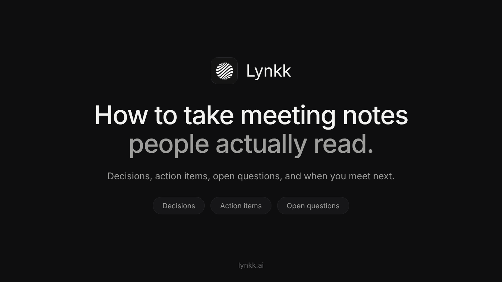
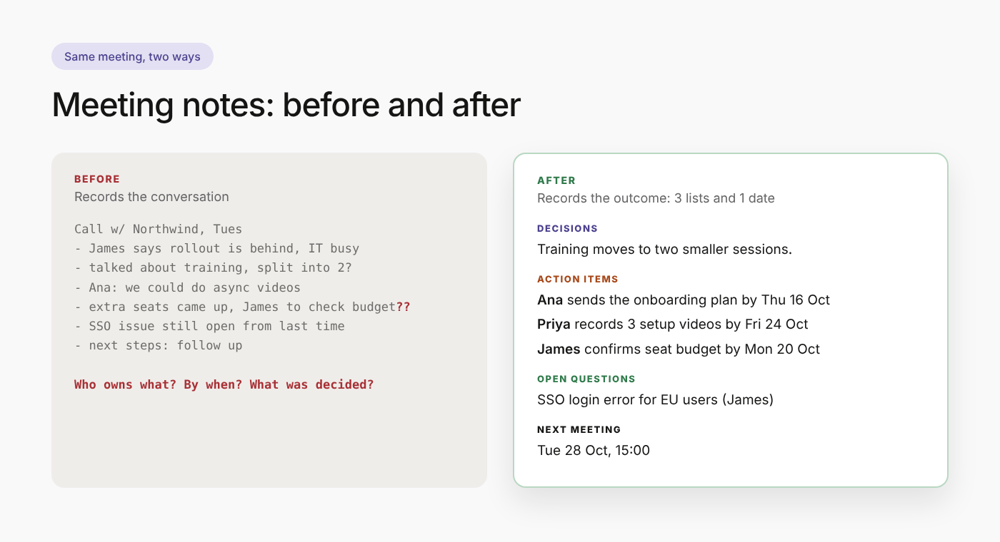

<!--
PLATFORM: Medium
Title (H1): How to Take Meeting Notes People Actually Read
Subtitle: Most meeting notes record the conversation. Useful ones record decisions, owners and dates. Here's a simple method, a before-and-after example, and a template you can copy.
SEO title (58 chars): How to Take Meeting Notes People Actually Read (+ Template)
SEO description (151 chars): How to take meeting notes that get read and acted on: the 3 lists + 1 date method, a before-and-after example, tips for live note taking, and a template.
Custom story link: how-to-take-meeting-notes
Tags (max 5): Productivity, Meetings, Note Taking, Management, Remote Work
Canonical: none (this is an original story, not a copy of the Blogger or Hashnode posts)
Keyword matrix: content/research/keyword-matrix.md (Article 3)
Primary keyword: how to take meeting notes (590, SD 44). A Medium story already ranks #5 for it.
Secondary: how to take good meeting notes (880, SD 16), how to write meeting notes (880, SD 36),
taking meeting notes (720), best way to take meeting notes (140), meeting notes (3,600, SD 29)
Images (in content/images, sources in content/images/src):
  Featured: medium-banner.png, 1400x788. Alt: "How to take meeting notes: decisions, action items, open questions and next meeting date"
  Inline: medium-before-after.png, 1400x760. Alt: "Meeting notes before and after: transcript-style notes vs 3 lists and a date"
Medium formatting: no tables (Medium doesn't support them), short paragraphs, 2 heading levels.
Medium rules: links are nofollow (referral + brand only). AI-assisted writing must be disclosed
in the first two paragraphs or the story is limited to followers. See publish/README.md.
-->

# How to Take Meeting Notes People Actually Read

You leave a 45-minute meeting with two pages of notes. A week later someone asks, "Wait, who said
they'd send the onboarding plan?" The answer is in your notes somewhere, between a half-sentence
about budgets and a quote you wrote down because it sounded important.

That's the problem with how most of us learned to take meeting notes. We record the
conversation. What people actually need is the outcome.

**The short answer:** to take meeting notes people read and act on, write down only three lists
and one date: the **decisions** made, the **action items** (each with one owner and one due date),
the **open questions**, and **when you meet next**. Everything else is optional. The rest of this
post shows how to do that live, what it looks like before and after, and a template you can copy.

## Why most meeting notes go unread

Notes fail in predictable ways:

- **They're chronological.** Notes follow the order of the conversation, so the one decision that
  matters is buried in paragraph six.
- **They mix "discussed" with "decided".** A reader can't tell whether "move launch to November"
  was an idea someone floated or something the group agreed.
- **Tasks have no owner.** "Follow up with legal" is a wish, not a task. Who follows up? By when?
- **They arrive too late.** Notes sent three days after the meeting are read by nobody, because
  everyone has already moved on.

Fix those four things and your notes become the most useful message anyone gets that week.

## The method: 3 lists and 1 date

Here's how to write meeting notes that people act on: think of them as a short form with four
fields. You're not writing an essay; you're
filling in boxes.

**1. Decisions.** What did the group agree on? One sentence each. If you're not sure something was
decided, it goes under open questions instead.

**2. Action items.** Every task gets a verb, one owner and a real date: *"Ana sends the revised
onboarding plan to James by Thursday."* Not "onboarding plan (Ana?)".

**3. Open questions.** Things raised but not resolved, with the name of whoever raised them. This
is the list that stops the same debate from restarting next week.

**4. Next meeting date.** When will you check on the action items? Write it down so the follow-up
actually happens.

That's it. Background, discussion details and context are allowed, but they go *below* these four
things, never above them.

## Before and after: the same meeting, two ways

Here's a real-world style example: a 30-minute call with a customer about a delayed onboarding.

**Before** (how most of us write meeting notes):

**Call w/ Northwind, Tues**

- James says rollout is behind, IT team busy w/ migration
- talked about training sessions, maybe split into 2 groups?
- Ana: we could do async videos
- pricing for extra seats came up, James to check budget??
- SSO issue still open from last time
- next steps: follow up

**After** (3 lists and 1 date):

**Northwind onboarding check-in, Tue 14 Oct** Attendees: James (Northwind), Ana, Priya

**Decisions**

- Training moves to two smaller sessions instead of one.
- Ana's team will record async videos for the admin setup.

**Action items**

- Ana sends the revised onboarding plan to James by Thu 16 Oct.
- Priya records the 3 admin setup videos by Fri 24 Oct.
- James confirms budget for 15 extra seats by Mon 20 Oct.

**Open questions**

- SSO login error for EU users: still unresolved (raised by James).

**Next meeting** Tue 28 Oct, 15:00. Start with the action items above.

Same meeting. Same information. But the second version answers every question anyone will ask
about this call in ten seconds, and it reads fine on a phone.

## How to take good meeting notes during the meeting

Writing clean notes live is a skill. These habits make it much easier.

**Set up the four headings before the meeting starts.** Open a doc and type four headings:
Decisions, Action items, Open questions and Next meeting. Now you're sorting as you listen instead of transcribing.

**Listen for decision words.** Phrases like "let's go with", "agreed", "so we'll" and "final
answer" are your cue to write something under decisions.

**Ask the magic question.** Whenever a task comes up without an owner or date, ask: *"Who's
taking that, and by when?"* It feels slightly awkward the first time. By the third meeting,
people start answering before you ask.

**Use shorthand, clean up later.** "A → plan → J, Thu" is fine during the call. You'll expand it
afterwards.

**Don't write down everything.** You're not a court stenographer. If a five-minute tangent didn't
change anything, it doesn't need to be in the notes.

**If you're running the meeting, don't also take the notes.** It's very hard to facilitate and
capture at the same time. Ask someone else to take notes, rotate the job weekly, or use a tool
(more on that below).

## After the meeting: the 10-minute cleanup

The best notes are sent within a few hours, while everyone still remembers the
conversation. Here's the routine:

1. Expand your shorthand into full sentences.
2. Check every action item has a verb, one owner and a date.
3. Move anything uncertain from decisions to open questions.
4. Send it to everyone who attended *and* everyone who was invited but missed it.
5. Use a subject line people can search for later: *"Notes: Northwind onboarding, 14 Oct"*.

Ten minutes, and nobody has to ask "what did we agree?" again.

## Copy this meeting notes template

Paste this into your notes app, a doc, or the body of an email:

**[Meeting name], [Date]** Attendees: [Names]

**Decisions**

- [Decision]

**Action items**

- [Owner] [verb] [task] by [date]
- [Owner] [verb] [task] by [date]

**Open questions**

- [Question] (raised by [Name])

**Next meeting** [Date, time]. Start with the action items above.

## Meeting notes vs meeting minutes

Notes are informal and written for the team. Meeting minutes are the formal record a board,
committee or association approves, often with motions and votes. The method above works for both,
but minutes need a few extra fields (chair, apologies, approval of previous minutes). If that's
what you need, here's a [free meeting minutes template with action items and a filled-in
example](BLOGGER_POST_URL).

## Should you let AI take your meeting notes?

Increasingly, people aren't taking meeting notes by hand at all. AI tools can record the call and
draft the notes, which frees you to actually take part in the conversation.

It works well when the tool follows the same structure as this post: decisions, action items with
owners and dates, open questions. It works badly when it produces a long narrative summary that
nobody reads, which is exactly the problem we started with.

Two ways to try it:

- **Do it yourself with ChatGPT or Claude.** Paste a transcript with a well-built prompt. Here's the
  [exact prompt we use to turn a meeting transcript into notes and Jira tickets](HASHNODE_POST_URL).
- **Use an AI meeting assistant.** Tools like [Lynkk](https://lynkk.ai/) join online meetings or
  record in-person conversations, and send structured notes with assigned action items about 30
  seconds after the call ends. Lynkk also keeps past meetings searchable, so you can ask what was
  agreed with a client months ago.

Either way, read the notes before you send them. AI is fast, but you're still the one who knows
what the meeting was actually about.

## Quick answers

**What is the best way to take meeting notes?**
Prepare four headings (decisions, action items, open questions, next meeting) before the meeting,
fill them in live, and send the cleaned-up notes within a few hours.

**What should meeting notes include?**
At minimum: date, attendees, decisions, action items with owners and due dates, open questions,
and the next meeting date.

**How do you write meeting notes quickly?**
Use shorthand during the meeting, skip anything that didn't change an outcome, and spend ten
minutes cleaning up right after the call.

*What's the worst meeting note you've ever received? Tell me in the responses.*
