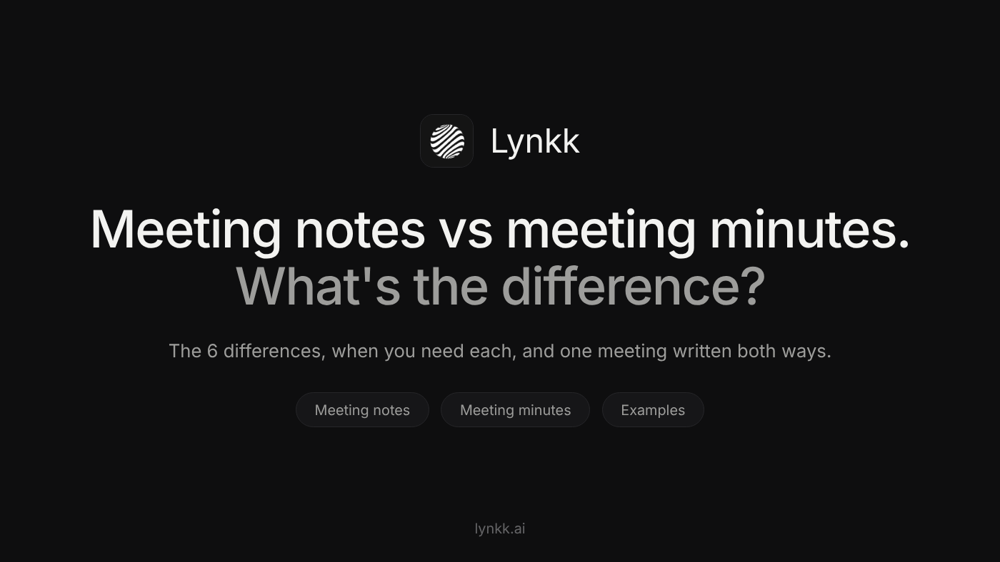
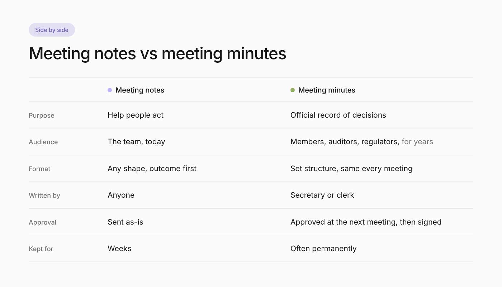

<!--
PLATFORM: Medium (second story)
Title (H1): Meeting Notes vs Meeting Minutes: What's the Difference? (With Examples)
Subtitle: They sound like the same thing, but they're not. Here's how to tell them apart, when you need each one, and the same meeting written both ways.
SEO title (57 chars): Meeting Notes vs Meeting Minutes: Differences + Examples
SEO description (153 chars): Meeting notes vs meeting minutes: the 6 differences, when you need each, and one real meeting written both ways. Plus how to combine them in one document.
Custom story link: meeting-notes-vs-meeting-minutes
Tags (max 5): Productivity, Meetings, Leadership, Nonprofit, Management
Canonical: none (original story)
Keyword matrix: content/research/keyword-matrix.md (Article 5)
Primary keyword: meeting notes vs meeting minutes (volume not pulled: Ubersuggest daily limit)
Secondary (Ubersuggest, US): meeting notes minutes (2,400, SD 17), what is meeting minutes (2,400, SD 36),
meeting minutes meaning (1,300, SD 28), minutes of meeting (1,900, SD 31), meeting minutes example (3,600, SD 36),
meeting minutes (9,900, SD 36), what is meeting notes (2,400, SD 64)
SERP (2026-10-16): page one is AI note-taker vendor blogs (tldv, fireflies, fellow, sembly, wudpecker,
audionotes). A neutral Medium story with a side-by-side example is the differentiator.
Images (content/images, sources in content/images/src):
  Featured: medium2-banner.png, 1400x788. Alt: "Meeting notes vs meeting minutes: what's the difference?"
  Inline: medium2-comparison.png, 1400x800 (replaces a table: Medium has no tables).
    Alt: "Meeting notes vs meeting minutes compared: purpose, audience, format, writer, approval, retention"
Medium formatting: no tables, 2 heading levels, code fences become plain lines in the Word/HTML exports.
-->

# Meeting Notes vs Meeting Minutes: What's the Difference? (With Examples)



Someone on your team says "can you take the minutes?" and you open a doc and start typing notes. Usually that's fine. Sometimes it really isn't: if you're on a board, a committee or a nonprofit, the minutes may be the official record of what the organization decided, and "Sara said something about the budget" won't cut it.

**The short answer:** meeting notes are an informal record written to help the people in the meeting get work done. Meeting minutes are the formal, official record of what a group decided, usually reviewed and approved at the next meeting. Notes focus on *what happens next*. Minutes focus on *what was decided*, in a form that can be checked later.

Below: what each one is, the six differences that matter, the same meeting written both ways, and how to pick the right one.

## What are meeting minutes?

Meeting minutes (often shortened to "minutes of meeting" or MoM) are the official written record of a meeting. They're common anywhere decisions need to be on the record: boards of directors, nonprofit boards, homeowners associations, committees, councils, unions and shareholder meetings.

Minutes typically include:

- the organization, date, time and place
- who chaired, who took the minutes, who attended and who sent apologies
- whether there was a quorum
- motions, who proposed them, and the result of each vote
- decisions and action items
- approval of the previous meeting's minutes
- a signature line once the minutes are approved

A principle worth remembering, popularized by *Robert's Rules of Order*: minutes are a record of **what was done** at a meeting, not a transcript of what was said. Long summaries of who argued what are usually left out.

## What are meeting notes?

Meeting notes are the working record of a meeting, written for the people who have to act on it. There's no required format and no approval step. Good meeting notes are short and outcome-first: decisions, action items with owners and dates, open questions, and the next meeting date.

You'll see notes in team syncs, project meetings, client calls, one-on-ones and standups: anywhere the goal is getting work done rather than creating an official record.

## The 6 differences that matter



**1. Purpose.** Notes help people act. Minutes create an official record of decisions.

**2. Audience.** Notes are for the team, today. Minutes are for the organization, members, auditors or regulators, possibly years from now.

**3. Format.** Notes can take any shape. Minutes follow a set structure, often the same template every meeting.

**4. Who writes them.** Anyone can take notes. Minutes are usually taken by a designated secretary or clerk.

**5. Approval.** Notes are sent as-is. Minutes are typically reviewed, corrected and approved at the next meeting, then signed.

**6. How long they're kept.** Notes are useful for weeks. Minutes are often kept permanently as part of the organization's records.

## Same meeting, written both ways

Here's a real-world style example: a 45-minute board meeting of a small nonprofit, the Riverside Community Garden. First, the **meeting minutes**:

```
RIVERSIDE COMMUNITY GARDEN, BOARD OF DIRECTORS
Minutes of the regular meeting, Tuesday 14 October 2026, 18:00
Location: Community hall, room 2

Present: M. Ortiz (Chair), J. Kim (Treasurer), A. Shah (Secretary), L. Novak, R. Diaz
Apologies: P. Grant
Quorum: present (5 of 6 directors)

1. APPROVAL OF MINUTES
The minutes of 9 September 2026 were approved without changes.

2. TREASURER'S REPORT
J. Kim reported a balance of $8,420. The report was accepted.

3. MOTION: NEW IRRIGATION SYSTEM
Moved by L. Novak, seconded by R. Diaz, to approve spending up to $3,200 on a drip irrigation system.
Vote: 4 in favor, 1 against, 0 abstentions. Motion carried.

4. ACTION ITEMS
J. Kim to obtain two more quotes by 31 October.
A. Shah to notify members of the decision by 21 October.

5. ADJOURNMENT
The meeting was adjourned at 18:45. Next meeting: 11 November 2026.

Approved: ____________ (Secretary)   Date: ________
```

Now the **meeting notes** a volunteer might send to the garden's working group after the same meeting:

```
Board meeting recap, Tue 14 Oct

DECISIONS
Board approved up to $3,200 for drip irrigation (vote 4 to 1).

ACTION ITEMS
Ji-woo gets two more irrigation quotes by Fri 31 Oct.
Aisha emails all members about the decision by Tue 21 Oct.
Lena drafts a volunteer rota for installation by Fri 7 Nov.

OPEN QUESTIONS
Install before winter or wait for spring? (Raised by Rosa)

NEXT MEETING
Tue 11 Nov, 18:00
```

Same meeting, two very different documents. The minutes prove what the board decided and how it voted. The notes tell volunteers what to do next, including an action item (the volunteer rota) that wasn't a board decision at all and doesn't belong in the official minutes.

## When do you need minutes, and when are notes enough?

**You probably need minutes if:**

- you're a board, committee or other formal body of an organization
- the meeting includes motions and votes
- decisions involve money, contracts, policies or people
- your bylaws, funders, auditors or regulators expect a record

**Notes are enough if:**

- it's a team, project or client meeting
- nothing needs to be formally approved
- the main goal is making sure work happens

When in doubt, ask: *"Could someone need to prove later what this group decided?"* If yes, write minutes.

## Can one document do both?

Yes, and for many teams that's the best option. Use a minutes structure (attendance, decisions, votes, approval line) and add a proper **action items** section with an owner and a due date for every task. You get an official record and a to-do list in one place.

If you want a starting point, here's a [free meeting minutes template with action items and a filled-in example](BLOGGER_POST_URL). For everyday team meetings, a lighter format works better; I wrote about that in [how to take meeting notes people actually read](MEDIUM_STORY_1_URL).

## Common mistakes with both

- **Minutes written like a transcript.** Record decisions and votes, not every comment.
- **Notes with no owners.** "Follow up on quotes" is not an action item. "Ji-woo gets two quotes by Friday" is.
- **Minutes that never get approved.** Unapproved minutes are a draft, not a record.
- **Editing minutes after approval.** Corrections are approved at the next meeting and recorded there.
- **Sending notes a week later.** Notes are most useful within 24 hours.

## Where AI fits in

AI meeting assistants can now record a meeting and draft both documents from the same conversation. Tools like [Lynkk](https://lynkk.ai/) produce structured notes with decisions and assigned action items about 30 seconds after a meeting ends, and keep past meetings searchable.

That's a big time saver for notes. For minutes, treat AI output as a first draft only: the secretary still needs to check names, motions and vote counts, and the board still needs to approve the minutes. An AI summary isn't an official record until people sign off on it.

## Quick answers

**Are meeting minutes a legal requirement?**
For many corporations, nonprofits and public bodies, keeping minutes of board or member meetings is required by law, bylaws or funders. The exact rules depend on where you are and what kind of organization you are, so check your bylaws and local rules.

**Who takes meeting minutes?**
Usually the secretary of the board or committee, or a clerk. For informal meetings, anyone can take notes.

**What does MoM mean?**
MoM stands for "minutes of meeting", another name for meeting minutes.

**Do meeting minutes need to be signed?**
Often, yes. Many organizations have the secretary or chair sign the minutes once they're approved at the next meeting.

---

*Which do you write more often, notes or minutes? Tell me in the responses.*
