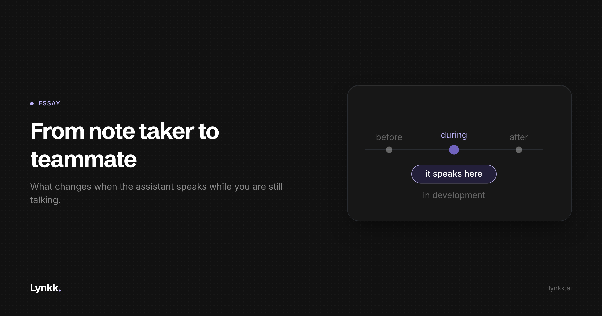

# From Note Taker to Teammate

<!-- Cover: dark theme, 2400x1260 (2x of 1200x630). Light variant at
     ../images/S4-from-note-taker-to-teammate/cover-light.png
     Hashnode: upload as the post cover, then delete this image line and comment.
     Substack/LinkedIn: upload as the header image, same. -->

**The next step in this category is software that participates while you are still talking. Almost nobody is discussing what that does to a meeting.**

Everything in the AI meeting category so far has been retrospective. The software listens, the meeting ends, the software writes something. It is a stenographer with good judgment.

The next step is visible already, and it is a different thing: software that acts while the conversation is happening. Surfacing the number somebody is trying to remember, pulling up what this customer was quoted four months ago, answering a question the person on the call cannot answer.

The interesting part is not whether it is technically possible. It is what it does to the social contract of a meeting.

## Three things break the moment the AI is live

**Latency stops being a performance metric and becomes a social one.** A summary that takes thirty seconds is fine. An answer that takes six seconds is unusable, because conversations have a rhythm and six seconds of silence in front of a customer is a visible failure. The target is not "fast", it is "inside the window where a human pause is still natural", and that window is about two seconds.

**Being wrong gets expensive immediately.** A post-call summary that misstates a number gets caught when someone reads it. A live assistant that surfaces the wrong price mid-sentence gets repeated out loud to a customer by a person who trusted it. The error does not wait in a document to be found.

**The other side has a legitimate interest in knowing.** If I am negotiating with you and you have a system feeding you my own previous statements in real time, something has changed about the negotiation, and you not mentioning it is a choice.

## Nobody has answered the etiquette question

We have rough norms for recording. You say you are recording, the other person says fine, everyone proceeds. Thin, but it exists.

We have no norms at all for live assistance. Is it like notes you prepared beforehand, which nobody expects you to disclose? Like a colleague messaging you during the call, which most people would accept? Or like having the customer's own words instantly retrievable, which starts to feel like something else?

I do not think there is a clean answer, and I am suspicious of anyone who offers one confidently. But three design positions seem clearly right, and they get decided by default if nobody argues for them.

**It should never be hidden from a screen share.** If the assistant disappears when you share your screen, the product was designed around concealment, and that tells you what it is for.

**It should read, not watch.** Taking the screen as text rather than as an image is a real privacy difference and limits what gets captured incidentally.

**It should be visibly the seller's tool.** The honest framing is "I have my notes open", not "I have an oracle".

## The good use is duller than you would guess

The instinctive use case is the uncomfortable one: real-time coaching on handling an objection, a script whispered in your ear. I think that is both the least useful application and the one that will give this category a bad name.

The genuinely valuable use is **retrieval of things that were actually said.** What did we quote them in March. What did they say their timeline was. Did we ever send the security document.

Those are questions with correct answers sitting in the record, and a human cannot retrieve them mid-sentence. That is a real capability gap, and closing it does not require the system to have opinions about the customer. It has to find the sentence and show you where it came from.

**Retrieval with a citation is help. Advice without one is a liability pointed at your own customer relationship.**

## The second-order effect nobody mentions

If live assistance works, it degrades the value of preparation, and preparation is currently how good sellers distinguish themselves.

Today the rep who reviewed the account history before a call is visibly better in it than the one who did not. If the system supplies that history on demand, the gap narrows. Mostly this is the usual story of a tool compressing a skill.

But it is worth being honest that "you no longer need to remember your customer" is a strange thing to sell to someone whose job is relationships. Some of what looks like preparation was actually attention, and attention does not survive being outsourced.

I do not know how that resolves. I suspect the people who stay good will use the retrieval to ask better questions rather than to avoid doing the reading.

## Where this actually is

Not shipped. Lynkk's Spotter is **in development**, with early access on the Mac app by request on the Pro plan. I am writing about a direction rather than a product you can buy today, and I would be sceptical of anyone claiming this problem is solved. The latency and false-confidence constraints are not small.

What I am confident about is the direction. Post-meeting summaries were never the destination, they were the easiest thing to build first.

## The takeaway

The real question was always whether software can be useful during a conversation rather than after it, and whether we can build that without quietly making meetings adversarial. The second half of that sentence is the actual work.

Watch which vendors ship live assistance that stays visible during a screen share. That one design choice will tell you more about a company's intentions than anything on its security page.

**If you have been on the other side of a call where someone was using live AI assistance, I want to hear how it felt. Reply and tell me.**
