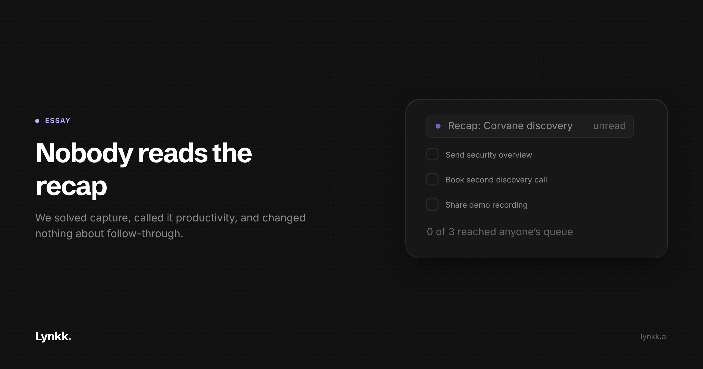

# Nobody Reads the Recap

<!-- Cover: dark theme, 2400x1260 (2x of 1200x630). Light variant at
     ../images/S2-nobody-reads-the-recap/cover-light.png
     Hashnode: upload as the post cover, then delete this image line and comment.
     Substack/LinkedIn: upload as the header image, same. -->

**We solved meeting capture, called it meeting productivity, and changed nothing about follow-through.**

Three years ago you left a meeting with nothing, or with half a page of your own handwriting. Now you leave with a structured summary, decisions, and action items with owners, in your inbox inside a minute.

Now the harder question: did the follow-through get better?

For most teams I have seen, no. **We replaced the unread handwritten note with an unread AI summary, at considerable expense, and called the problem solved because the artefact got better looking.**

## A summary is retrospective. Follow-through is prospective.

That is the whole problem in one line. A summary records what happened. Follow-through requires something to happen next. Building a very good tool for the first does nothing for the second.

There is a decent argument it makes things slightly worse. A tidy record creates the feeling that the loop has closed. It has not closed. It has been documented.

Watch what actually happens. The recap arrives. Someone glances at it on their phone between two other calls. It lists four action items, two of which belong to other people and one of which they already knew about.

None of them enter any system where work is tracked. By Thursday it is below the fold in a thread. The information was captured perfectly and nothing moved.

## Three failures hide inside "action items"

**Owners that are not people.** "The team to follow up on pricing" will never be done, and everyone reading it knows that instantly. Unassigned work is a note about work.

**Dates that mean nothing.** "Soon", "next week", "after the review". A commitment without a date is a sentiment.

**No destination.** The big one. An action item that lives only in the recap lives in a document nobody opens. It has to arrive where the person already works: the issue tracker, the CRM task list, the thing they check on Monday.

None of those three are capture failures. The AI heard the commitment correctly. The system stopped one step early, at the point where information became a document instead of a task.

## The list you need runs across meetings, not within them

Recaps are organised around the meeting: here is what this group discussed and decided.

But almost nobody's actual problem is "what did that meeting decide". It is "what did I promise, to whom, and have I done it". That list spans every meeting they had, which means the recap format cannot represent it. You get fifteen recaps, each holding one of your promises, and no list of your promises.

For anyone customer-facing, that list is the most valuable thing in their week and the most expensive thing to get wrong. The sentences starting "I'll send you" are remembered indefinitely by the customer and forgotten within hours by the person who said them.

Not through carelessness. They said it out loud in the middle of a conversation about something else, and nothing wrote it down anywhere they will look.

## What would actually help

**Commitments extracted across meetings, not within them.** One list per person of every promise they made, with the moment they made it. That is a different query from "summarise this call", and it is the one people need.

**Write to the system of record, not to a document.** The test of a meeting tool should be whether anything appeared in the issue tracker or the CRM task list afterwards. If the only artefact is a summary, the loop is open.

**The draft, not the reminder.** Telling someone they owe a follow-up email is a nag. Having it drafted, with the numbers and promises from the call already in it, is help. That difference is most of the actual value.

**A human at the point of sending.** I would argue against automating the send. Once a system emails customers on your behalf you have to read everything it sends anyway, and now you are reviewing rather than writing, which is the worse job.

## The part no software fixes

A meaningful share of this is not solvable by anybody's product.

If your team has back-to-back calls from nine to six, no amount of automated follow-through fixes it, because there is no hour in which follow-through could happen. The recap is not the bottleneck. The calendar is.

Tools promising to make meeting overload survivable are treating a symptom, and we should be honest that we are selling into a problem partly created by meetings being too cheap to schedule. **The most effective meeting intervention I know of remains deleting the meeting.** No vendor will tell you that, which is a reason to be slightly suspicious of all of us.

## The takeaway

Capture is solved. Follow-through never was a capture problem. It is whether something said out loud ever reaches the place where the work actually lives.

The next useful thing in this category will not be a better summary format. It will be plumbing: commitments extracted across meetings and written into the systems people already open. Watch for who builds that instead of shipping another recap template.

Stop measuring whether the summary was good. Measure whether anything happened.

**What is your team's actual follow-through rate on meeting action items? Reply with a number if you have one. Almost nobody measures it, which is the point.**
