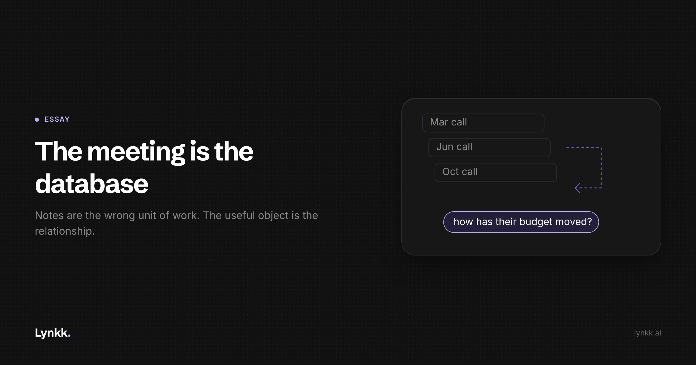

# The Meeting Is the Database

<!-- Cover: dark theme, 2400x1260 (2x of 1200x630). Light variant at
     ../images/S1-the-meeting-is-the-database/cover-light.png
     Hashnode: upload as the post cover, then delete this image line and comment.
     Substack/LinkedIn: upload as the header image, same. -->

**Every tool in this category summarises one call. The questions people actually ask span fifteen.**

Thirty seconds after a call ends, you have a tidy artefact: bullet points, decisions, action items. It is genuinely useful. It is also the wrong unit of work, and I think that single mistake is why the whole category plateaus in the same place.

Nobody wakes up wanting a recap of Tuesday's call. They want to know whether a deal is real, what a customer has been promised, and what has changed since anyone last spoke to them. Those are not questions about a meeting.

They are questions about a relationship, and the answer lives across fifteen conversations rather than inside one.

## Notes inherit a model built for governance

The mental model behind meeting notes is the minute book. Something was discussed, so it must be recorded, so there is a record. That comes from governance, where the record genuinely is the point: the board resolved X on date Y, and the document exists to be referred back to.

Sales conversations do not work that way. Nobody refers back to a single sales call. They refer back to a customer.

And the shape of the useful answer is almost never "what happened in this meeting". It is "how did we get here". How has their budget moved? When did IT first come up? Which of the four people on their side has actually said anything this month?

Every one of those requires reading across calls, in order, and noticing change. A folder of beautifully summarised individual meetings is close to useless for all of them. You built an archive and the question needed a sequence.

## Three things exist only between meetings

Look at it this way and you notice that the most decision-relevant information in a customer relationship is structurally invisible to a per-meeting tool.

**Change.** A customer who said $30,000 in March and $50,000 in October has told you something important. Neither of those notes contains it. The information is in the delta, and the delta has no home in a system that stores one note per call.

**Silence.** The economic buyer who attended the first two calls and has not spoken since is the most predictive fact about a late-stage deal. It is, by definition, in no note, because nothing was said. You see it only by looking across the sequence and noticing an absence.

**The commitment ledger.** Every "I'll send you that" ever uttered, tracked against whether it was sent. Each promise sits in one note. The thing you need is the list, which exists in no note at all.

Three of the most useful properties of a relationship, and all three live in the gaps between the documents.

## What follows, if the relationship is the unit

**Conversations have to be queryable, not readable.** The output format matters less than whether you can ask a question across all of it. Reading is what you do when you cannot ask.

**The citation is the product.** An AI that tells you a customer's budget went up is a liability. One that tells you it went up and plays the eleven seconds where they said it is a tool. Sales decisions get made on these answers, and a confident paraphrase is how optimism enters a forecast.

**The before matters as much as the after.** If the point is the sequence, the most valuable moment to deploy any of this is not after a call. It is the ninety seconds before the next one.

**Capture has to be total, or the sequence has holes.** A memory with gaps where the in-person meeting and the call somebody took from a car should be is a sample, not a memory. The incentive to build only for the scheduled video call with a link is strong, and it produces exactly those holes.

## Two things that cut against my own argument

If the relationship is the unit, switching costs become enormous, and that is not obviously good for customers. A per-meeting notes tool is easy to leave: you lose a folder of summaries. A system holding four years of account history is hard to leave, and vendors know it.

The right response is to make export genuinely complete and say so plainly, rather than enjoying the lock-in quietly. **Anyone evaluating this category should ask what export looks like before asking what the summary looks like.**

The second: an organisation that remembers every commitment is one where every commitment can be checked. That is mostly good and occasionally oppressive. Which one depends entirely on whether the system is pointed at helping the rep or auditing them, and that is a management decision no vendor can make for you.

## The takeaway

The category will keep getting better at summarising calls, and that will keep not being the thing. The summary was always a proxy for what people wanted, which was to stop holding a customer relationship in their head.

Watch for which tools start answering questions across calls with the source attached, and which keep shipping prettier recaps. That split is the next two years of this market.

The meeting is not the document. The meeting is a write to the database, and the product is the query.

**If you have run an account where the sequence mattered and a single note would have missed it, reply and tell me. Those examples are what this argument needs.**
