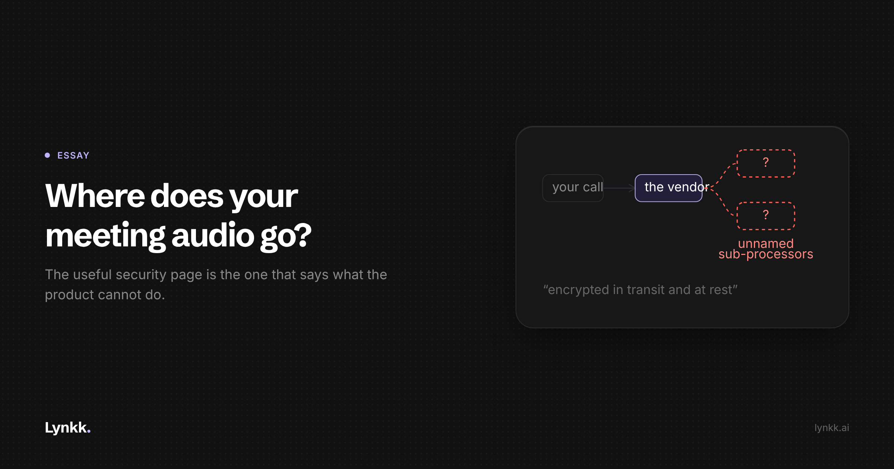

# Where Does Your Meeting Audio Go?

<!-- Cover: dark theme, 2400x1260 (2x of 1200x630). Light variant at
     ../images/S3-where-does-your-meeting-audio-go/cover-light.png
     Hashnode: upload as the post cover, then delete this image line and comment.
     Substack/LinkedIn: upload as the header image, same. -->

**Every notetaker says the same three things about security. None of them answers the question buyers are asking.**

Encryption in transit and at rest. SOC 2, or SOC 2 in progress. We take your privacy seriously.

Those three sentences appear on essentially every security page in this category, and not one of them answers what a buyer actually wants to know: **what happens to the recording of my customer's voice, and who can hear it?**

So I want to argue for an uncomfortable standard: in this category, the useful security page is the one that tells you what the product **cannot** do.

## Four claims that sound like answers

**"Encrypted in transit and at rest."** True of essentially every SaaS product built in the last decade, including bad ones. It says nothing about who reads the data once it is decrypted for use, which is the actual question.

**"SOC 2 Type II."** A SOC 2 report says a company followed the controls it told an auditor it follows. That is worth something, and it is a statement about process rather than about your audio. A company can hold SOC 2 while sending recordings to four sub-processors and retaining them for seven years.

**"We don't sell your data."** Nobody in B2B SaaS sells data. The question is whether they train on it.

**"Enterprise-grade security."** Not a claim. A texture.

## Five questions that discriminate

If I were buying one of these tools, I would ask these and treat a vague answer as a no.

**Do you train models on my conversations?** The only acceptable answers are "no, never" or a clear description of the opt-in. "We may use aggregated anonymised data to improve our services" is a yes wearing a coat. Get it in the contract, not the marketing page.

**Who are your sub-processors, by name?** Every tool here sends audio to a speech-to-text provider and a language model provider, usually third parties. Your customer's voice is processed by at least two companies you never evaluated. A vendor that will not name them is asking you to accept a supply chain you cannot see.

**Where is it processed, and can I constrain that?** Not where the company is incorporated. Where the audio physically goes. Many vendors process across multiple jurisdictions, and the honest ones say so on the page.

**What is the retention default?** How long do you hold the audio, the transcript and the derived notes, and are those three different? Most buyers assume deleting a note deletes the recording.

**Is it end-to-end encrypted?** The one almost nobody asks, and the one with the most interesting answer.

## The thing the category cannot admit

A meeting assistant has to read your conversation to write a note about it. That is the product. The service therefore has plaintext access to the content of your meetings at the moment it processes them.

That is not a flaw to be engineered away. It is the shape of the thing. An end-to-end encrypted meeting assistant that produces summaries is, for practical purposes, a contradiction.

So when a security page leads with "encrypted in transit and at rest" and never mentions this, it is not lying. It is allowing you to form a conclusion the vendor knows is wrong. The buyer walks away believing their customer conversations are sealed, and they are not sealed. They are readable by the service, briefly, to do the job you hired it for.

**I would rather a vendor said that in one sentence.** Lynkk's security page does: "Lynkk isn't end-to-end encrypted, because it has to read a recording to write the note." That sentence is worth more to a buyer than any badge, because it tells you what else on the page you can trust.

## What a security page should contain

**Named limits**, in plain words. What the product does not do.

**Numbers, not adjectives.** "Upload links expire after 10 minutes." "The desktop app deletes its local copy after 7 days." You can verify those. You cannot verify "robust".

**The access model.** Who inside my own organisation can read a note. Can an admin? Do they get the recording as well as the text? Is there a setting that excludes a conversation?

**Scoped encryption claims.** If AES-256 covers your integration tokens, say it covers your integration tokens. A blanket AES-256 badge over a page where that is the narrow truth is the most common piece of misdirection in this category.

**Export and deletion as mechanics**, not as a promise. Where the button is and what arrives.

## If you work in a regulated field

If you are a therapist, lawyer, financial adviser or clinician, most of this category is not built for you, whatever the landing page says about your profession. The five questions become threshold requirements, you need a signed agreement rather than a policy page, and "HIPAA compliant" on a marketing site is a claim to verify in a contract.

The economics tell you something here. These are the highest-value search terms in the entire category, which means you are being marketed to very hard by people who may not be able to support the claim.

## The takeaway

Publish what you cannot do. Name your sub-processors. Give numbers for retention. Say the thing about end-to-end encryption out loud.

I would rather compete against vendors who do all four, because the current equilibrium, where everyone says "enterprise-grade" and nobody says what is true, is one where the least careful vendor sounds exactly like the most careful one. Watch whether any vendor in this category publishes a named sub-processor list in the next year. That is the signal worth tracking.

**If you have asked a notetaker vendor the sub-processor question, reply and tell me what they said. I am collecting answers.**

---

## BLOCKERS: do not publish until resolved

1. **Security and legal sign-off.** This holds Lynkk to a standard publicly, which is the point and also a commitment.
2. **Sub-processors.** The essay says vendors should name theirs. Lynkk's security page says audio goes to speech-to-text and AI model providers without naming them. Either name them before this publishes, or cut that question. Publishing a standard you visibly fail is worse than not publishing.
3. **Retention figures.** The 10-minute and 7-day numbers come from the live security page. Confirm current.
4. **HIPAA.** Confirm Lynkk makes no HIPAA claim anywhere, including sales decks, before this goes out.
5. **No accuracy or SOC 2 claim appears here**, deliberately. Keep it that way.
